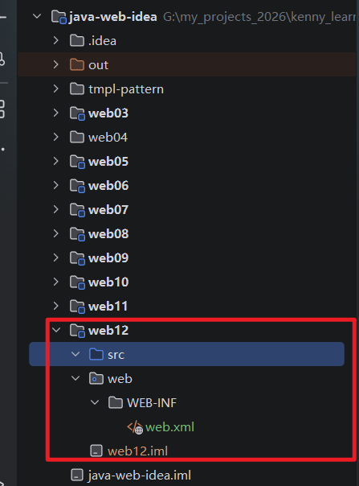
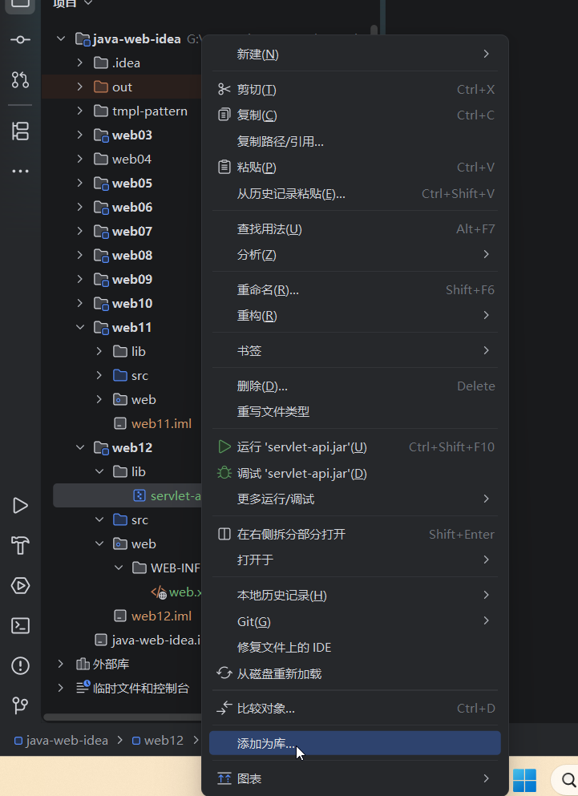
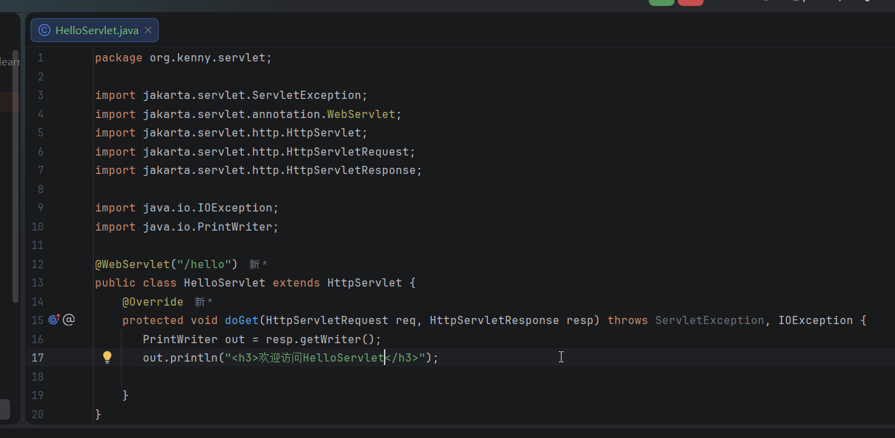
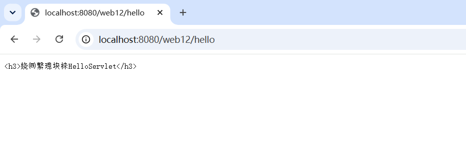
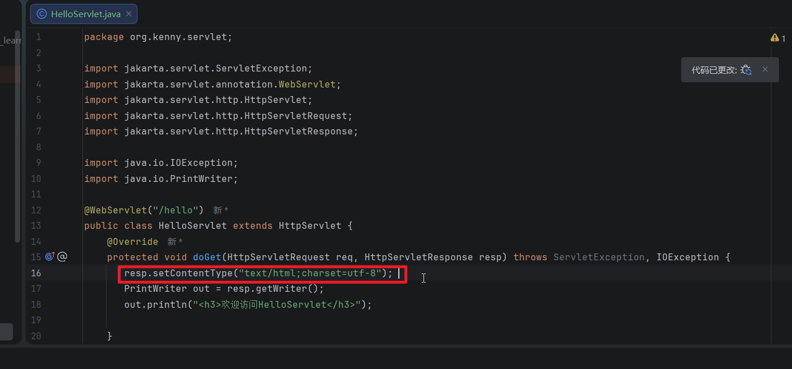
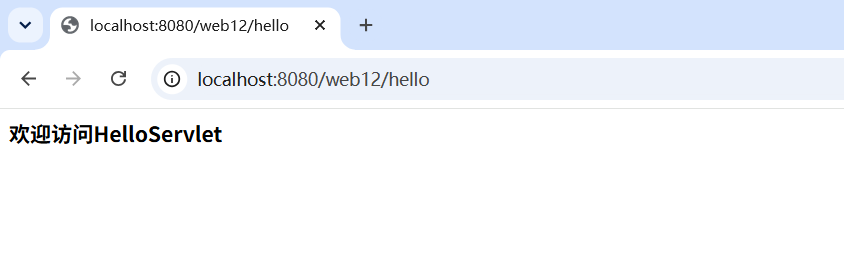
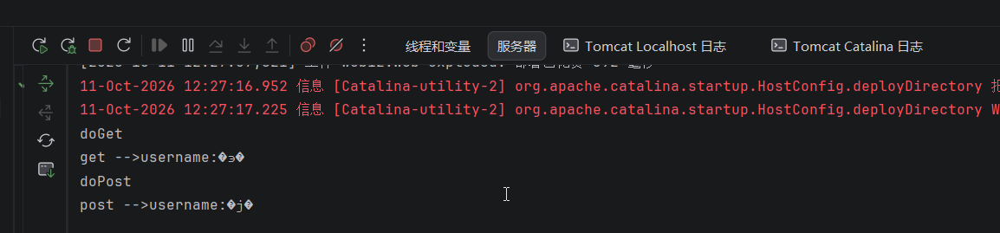
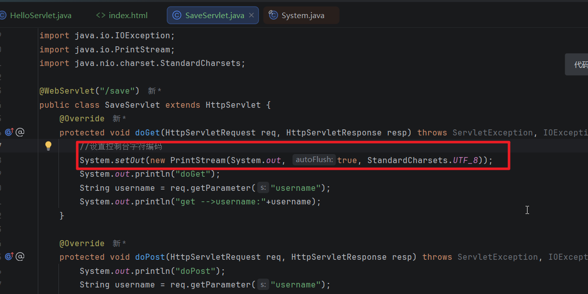
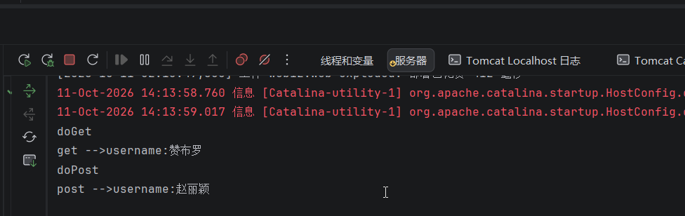
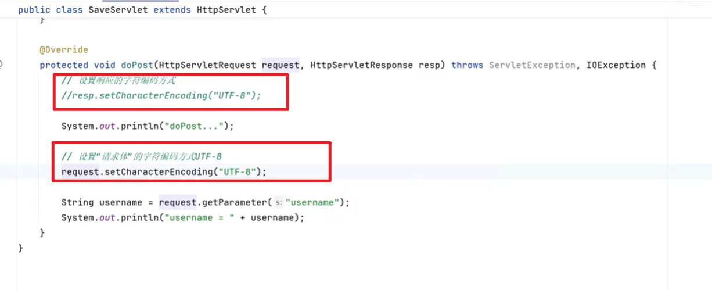

# 在学习Thymeleaf之前，我们需要来了解一下请求的乱码处理

## 解决响应的里面

## 1，新建一个模块web12，添加web支持，配置构件，部署到服务器



## 2.在项目根目录下面创建一个lib文件夹，把servlet-api.jar拷贝粘贴过来，然后作为库添加到classpath



## 3.创建一个org.kenny.servlet包，然后新建一个HelloServlet类，用注解配置路径"/hello",然后实现doGet方法，此时我们如果直接输出文本到页面，代码如下



### 程序运行后，用浏览器访问就会程序乱码



## 4.解决办法也很简单，需要在resp对象里面设置编码





## 解决请求的乱码

## 5.在web文件夹乱码新建一个index.html,创建2个表单，一个是get请求。另外一个是post请求，内容如下

```
<!DOCTYPE html>
<html lang="en">
<head>
    <meta charset="UTF-8">
    <title>首页</title>
</head>
<body>
<h3>Get请求</h3>
<form method="get" action="/web12/save">
    <label>
        用户名：<input name="username" type="text" />
    </label>
    <button>提交</button>
</form>
<h3>Post 请求</h3>
<form method="post" action="/web12/save">
    <label>
        用户名：<input name="username" type="text"/>
    </label>
    <button>提交</button>
</form>
</body>
</html>
```

## 6.然后我们新建一个SaveServlet，继承自HttpServlet，用注解配置路径"/save",实现doGet和doPost方法

```
package org.kenny.servlet;

import jakarta.servlet.ServletException;
import jakarta.servlet.annotation.WebServlet;
import jakarta.servlet.http.HttpServlet;
import jakarta.servlet.http.HttpServletRequest;
import jakarta.servlet.http.HttpServletResponse;

import java.io.IOException;

@WebServlet("/save")
public class SaveServlet extends HttpServlet {
    @Override
    protected void doGet(HttpServletRequest req, HttpServletResponse resp) throws ServletException, IOException {
        System.out.println("doGet");
        String username = req.getParameter("username");
        System.out.println("get -->username:"+username);
    }

    @Override
    protected void doPost(HttpServletRequest req, HttpServletResponse resp) throws ServletException, IOException {
        System.out.println("doPost");
        String username = req.getParameter("username");
        System.out.println("post -->username:"+username);
    }
}

```

### 启动服务器，就会自动打开index.html,然后我们分别发送get请求和post请求。发现控制台输出的是乱码



### 解决方法是：

##### 使用System.setOut(new PrintStream(System.out,StandardCharsets.UTF_8))



## 效果：



### 注意： 请求对象和响应对象都可以设置字符编码，如果请求体乱码可能响应用请求对象设置编码的方式来解决

