# Thymeleaf学习

## 当前项目弊端

1. **<font style="color:rgb(64, 64, 64);">代码耦合性高，难以维护</font>**

<font style="color:rgb(64, 64, 64);">前端代码（HTML/CSS/JS）与后端Java逻辑混杂在同一个Servlet中，违反</font>**<font style="color:rgb(64, 64, 64);">关注点分离（SoC）</font>**<font style="color:rgb(64, 64, 64);">原则。修改前端时需要重新编译Servlet，调试困难；团队协作时前后端开发者互相干扰。</font>

<font style="color:rgb(64, 64, 64);"></font>

2. **<font style="color:rgb(64, 64, 64);">开发效率低</font>**

<font style="color:rgb(64, 64, 64);">Java字符串拼接HTML（如</font><code>**<font style="color:rgb(64, 64, 64);background-color:rgb(236, 236, 236);">out.println("<div>...</div>")</font>**</code><font style="color:rgb(64, 64, 64);">）极其繁琐且易错。</font>

<font style="color:rgb(64, 64, 64);"></font>

3. **<font style="color:rgb(64, 64, 64);">安全性风险</font>**

**<font style="color:rgb(64, 64, 64);">XSS漏洞</font>**<font style="color:rgb(64, 64, 64);">：手动拼接HTML容易遗漏转义导致 XSS 攻击。</font>

**<font style="color:rgb(64, 64, 64);">XSS（Cross-Site Scripting）</font>**<font style="color:rgb(64, 64, 64);"> 是一种攻击方式，黑客通过注入恶意脚本（通常是JavaScript）到网页中，使其在其他用户的浏览器里执行。</font>**<font style="color:rgb(64, 64, 64);">后果</font>**<font style="color:rgb(64, 64, 64);">：窃取用户Cookie、篡改页面内容、重定向到恶意网站等。</font>

<font style="color:rgb(64, 64, 64);">假设有一个Servlet，接收用户输入的</font><code>**<font style="color:rgb(64, 64, 64);background-color:rgb(236, 236, 236);">name</font>**</code><font style="color:rgb(64, 64, 64);">并显示在页面上：</font>

```java
String userName = request.getParameter("name"); // 用户输入
out.println("<div>Welcome, " + userName + "!</div>");
```

<font style="color:rgb(64, 64, 64);">如果用户输入的是：</font>

```java
<script>alert('XSS Attack!');</script>
```

<font style="color:rgb(64, 64, 64);">最终生成的HTML会是：</font>

```java
<div>Welcome, <script>alert('XSS Attack!');</script>!</div>
```

<font style="color:rgb(64, 64, 64);">浏览器会执行这段脚本，弹出一个警告框（实际攻击可能是窃取Cookie或跳转到恶意网站）。如何解决这个问题，可以手动转义。</font>

<font style="color:rgb(64, 64, 64);">但手动转义容易遗漏，因此现代框架（如JSP、Thymeleaf、React、Vue）默认会自动转义。</font>

<font style="color:rgb(64, 64, 64);"></font>

4. **<font style="color:rgb(64, 64, 64);">可测试性差</font>**<font style="color:rgb(64, 64, 64);">：前端逻辑与后端深度耦合，无法独立测试。</font>

<font style="color:rgb(64, 64, 64);"></font>

5. **<font style="color:rgb(64, 64, 64);">多端适配困难</font>**<font style="color:rgb(64, 64, 64);">：同一Servlet无法灵活响应Web/移动端（不同HTML结构或API格式）。</font>

## Thymeleaf 概述

官网地址：<https://www.thymeleaf.org/>

**<font style="color:rgb(51, 51, 51);">引用官网（2026 年 4 月）： Thymeleaf 3.1.5.RELEASE</font>**<font style="color:rgb(51, 51, 51);"> is the latest version. It requires </font>**<font style="color:rgb(51, 51, 51);">Java SE 8</font>**<font style="color:rgb(51, 51, 51);"> or newer（翻译：目前最新发布版 3.1.5，要求 JDK 版本最低 8）</font>

<font style="color:rgb(51, 51, 51);"></font>

Thymeleaf 是一个用于 Web 和独立环境的**现代 Java 模板引擎**，主要用于处理 HTML、XML、JavaScript 等文件，支持自然模板（允许静态原型直接作为模板使用）。它由**Daniel Fernández**领导的团队开发，最初于**2011年**发布，旨在替代 JSP，提供更优雅的模板解决方案。Thymeleaf 强调语法简洁、与 Spring 框架深度集成，常用于 Spring Boot 项目。目前（截至 2026 年 6 月）仍在积极维护，最新稳定版本为 3.1.5，社区活跃且持续更新。

**<font style="color:rgb(64, 64, 64);">Java模板引擎</font>**<font style="color:rgb(64, 64, 64);">是一种用于动态生成文本（如HTML、XML、邮件内容等）的工具，它通过将</font>**<font style="color:rgb(64, 64, 64);">静态模板文件</font>**<font style="color:rgb(64, 64, 64);">和</font>**<font style="color:rgb(64, 64, 64);">动态数据</font>**<font style="color:rgb(64, 64, 64);">结合，生成最终的输出内容。</font>

现代开发中项目多数是前后端分离，Thymeleaf 这种模板技术市场份额在减少，为什么还要保留 Thymeleaf？

* **<font style="color:rgb(64, 64, 64);">简单页面需求</font>**<font style="color:rgb(64, 64, 64);">：对于管理后台、报表打印、静态内容页等</font>**<font style="color:rgb(64, 64, 64);">无需复杂前端交互</font>**<font style="color:rgb(64, 64, 64);">的场景，Thymeleaf直接生成HTML比搭建全套前后端分离项目更高效。</font>
* **<font style="color:rgb(64, 64, 64);">快速原型开发</font>**<font style="color:rgb(64, 64, 64);">：初期验证阶段，用Thymeleaf快速渲染页面比协调前后端联调更省时。</font>
* **<font style="color:rgb(64, 64, 64);">SEO友好</font>**<font style="color:rgb(64, 64, 64);">：搜索引擎直接抓取服务端渲染的HTML（前后端分离的SPA需额外SSR处理）。</font>
* **<font style="color:rgb(64, 64, 64);">支持混合模式</font>**<font style="color:rgb(64, 64, 64);">：Thymeleaf允许在传统服务端渲染中逐步引入前端框架（如部分页面用Vue，其他仍用Thymeleaf），适合遗留系统改造。</font>
* **<font style="color:rgb(64, 64, 64);">邮件模板</font>**<font style="color:rgb(64, 64, 64);">：动态生成HTML邮件内容时，模板引擎仍是标准方案。</font>
* **<font style="color:rgb(64, 64, 64);">PDF/Excel导出</font>**<font style="color:rgb(64, 64, 64);">：通过模板生成结构化文档（如Apache POI + Thymeleaf）。</font>

## <font style="color:rgb(64, 64, 64);">Thymeleaf 处理流程</font>

```html
<!-- 模板文件 index.html -->
<html>
  <body>
    <p th:text="'Hello, ' + ${name}">Hello, Guest</p>
  </body>
</html>
```

<font style="color:rgb(64, 64, 64);">Thymeleaf 的处理步骤：</font>

1. <font style="color:rgb(64, 64, 64);">模板解析：解析 HTML，识别 </font><code>**<font style="color:rgb(64, 64, 64);background-color:rgb(236, 236, 236);">th:text</font>**</code><font style="color:rgb(64, 64, 64);"> 表达式。</font>
2. <font style="color:rgb(64, 64, 64);">表达式处理：计算表达式 </font><code>**<font style="color:rgb(64, 64, 64);background-color:rgb(236, 236, 236);">${name}</font>**</code><font style="color:rgb(64, 64, 64);">（从 Servlet 作用域中获取值或从 Spring MVC 的 Model 中获取值）。</font>
3. <font style="color:rgb(64, 64, 64);">渲染阶段：替换静态文本（</font><code>**<font style="color:rgb(64, 64, 64);background-color:rgb(236, 236, 236);">Hello, Guest</font>**</code><font style="color:rgb(64, 64, 64);">）为动态值（如 </font><code>**<font style="color:rgb(64, 64, 64);background-color:rgb(236, 236, 236);">Hello, Alice</font>**</code><font style="color:rgb(64, 64, 64);">）。</font>

<font style="color:rgb(64, 64, 64);"></font>

<font style="color:rgb(64, 64, 64);">提示：</font>

1. <font style="color:rgb(64, 64, 64);">Thymeleaf 模板是合法的 HTML，可直接用浏览器打开预览。</font>

2. <font style="color:rgb(64, 64, 64);">Thymeleaf 默认对所有表达式输出进行 </font>**<font style="color:rgb(64, 64, 64);">HTML 转义</font>**<font style="color:rgb(64, 64, 64);">，有效防御 XSS。</font>

3. <font style="color:rgb(64, 64, 64);">Thymeleaf </font>**<font style="color:rgb(64, 64, 64);">不依赖 Servlet 容器</font>**<font style="color:rgb(64, 64, 64);">，可以在非 Web 环境（如邮件模板）中使用。</font>

4. <font style="color:rgb(64, 64, 64);">Thymeleaf </font>**<font style="color:rgb(64, 64, 64);">无 Java 代码嵌入</font>**<font style="color:rgb(64, 64, 64);">：所有逻辑通过属性（如 </font><code>**<font style="color:rgb(64, 64, 64);background-color:rgb(236, 236, 236);">th:text</font>**</code><font style="color:rgb(64, 64, 64);">、</font><code>**<font style="color:rgb(64, 64, 64);background-color:rgb(236, 236, 236);">th:if</font>**</code><font style="color:rgb(64, 64, 64);">）实现。</font>

   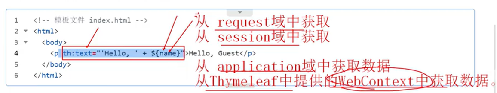

## Servlet 中使用 Thymeleaf

### 添加Thymeleaf 的 jar 包

jar 包从 apache 提供的 maven 中央仓库中下载，地址：<https://repo.maven.apache.org/maven2/>

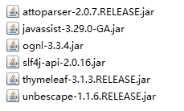

### 正确的maven仓库地址：https://mvnrepository.com/

将 jar 包拷贝 `WEB-INF/lib`目录下，并且只需要将 `thymeleaf-3.1.3.RELEASE.jar`添加到 classpath 中：

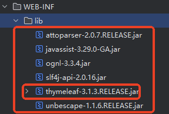

### 初始化模板引擎

写一个 ServletContextListener 监听器，在服务器启动阶段，初始化 Thymeleaf 的模板引擎：

```java
package com.jkweilai.thymeleaf.listeners;

import jakarta.servlet.ServletContext;
import jakarta.servlet.ServletContextEvent;
import jakarta.servlet.ServletContextListener;
import jakarta.servlet.annotation.WebListener;
import org.thymeleaf.TemplateEngine;
import org.thymeleaf.templatemode.TemplateMode;
import org.thymeleaf.templateresolver.WebApplicationTemplateResolver;
import org.thymeleaf.web.servlet.JakartaServletWebApplication;

@WebListener
public class ThymeleafInitializer implements ServletContextListener {
    @Override
    public void contextInitialized(ServletContextEvent sce) {
        // 获取ServletContext对象
        ServletContext application = sce.getServletContext();

        // 创建Thymeleaf与Servlet的适配器，用它处理Web请求
        JakartaServletWebApplication jakartaServletWebApplication = JakartaServletWebApplication.buildApplication(application);
        // 传入适配器，创建模板解析器
        WebApplicationTemplateResolver templateResolver = new WebApplicationTemplateResolver(jakartaServletWebApplication);

        // 设置模板文件存放的基础路径
        templateResolver.setPrefix("/WEB-INF/templates/");
        // 设置模板文件的后缀名
        templateResolver.setSuffix(".html");
        // 指定解析模式为HTML，启用HTML特有语法支持
        templateResolver.setTemplateMode(TemplateMode.HTML);
        // 禁用模板缓存（开发环境建议关闭，确保开发时修改模板立即生效）
        templateResolver.setCacheable(false);

        // 创建模板引擎
        TemplateEngine templateEngine = new TemplateEngine();
        // 模板引擎关联模板解析器
        templateEngine.setTemplateResolver(templateResolver);

        // 把适配器保存到ServletContext，供后续请求使用
        application.setAttribute("jakartaServletWebApplication", jakartaServletWebApplication);
        // 把模板引擎保存到ServletContext，供所有Servlet共享使用
        application.setAttribute("templateEngine", templateEngine);
    }
}
```

### 编写 Servlet

```java
package com.jkweilai.thymeleaf.servlets;

import jakarta.servlet.ServletContext;
import jakarta.servlet.ServletException;
import jakarta.servlet.annotation.WebServlet;
import jakarta.servlet.http.HttpServlet;
import jakarta.servlet.http.HttpServletRequest;
import jakarta.servlet.http.HttpServletResponse;
import org.thymeleaf.TemplateEngine;
import org.thymeleaf.context.WebContext;
import org.thymeleaf.web.servlet.JakartaServletWebApplication;

import java.io.IOException;
import java.time.LocalDateTime;
import java.time.format.DateTimeFormatter;

@WebServlet("/hello")
public class HelloServlet extends HttpServlet {
    @Override
    protected void doGet(HttpServletRequest request, HttpServletResponse response) throws ServletException, IOException {
        // 向request域中绑定数据
        request.setAttribute("message", "Hello from Request Scope!");
        request.setAttribute("currentTime", LocalDateTime.now().format(DateTimeFormatter.ISO_LOCAL_DATE_TIME));
        request.setAttribute("requestURI", request.getRequestURI());

        // 交给模板引擎去处理
        response.setContentType("text/html;charset=UTF-8");
        ServletContext application = getServletContext();
        // 从上下文中获取Thymeleaf的Servlet适配器实例
        JakartaServletWebApplication jakartaServletWebApplication = (JakartaServletWebApplication)application.getAttribute("jakartaServletWebApplication");
        // 从上下文中获取Thymeleaf模板引擎实例
        TemplateEngine templateEngine = (TemplateEngine) application.getAttribute("templateEngine");
        // 创建Thymeleaf上下文对象，包装当前请求/响应和语言环境
        // buildExchange() 把 request/response 包装成 Thymeleaf 的 IWebExchange 接口对象（Thymeleaf不依赖Servlet API）
        // request.getLocale() 获取浏览器期望的语言偏好
        // WebContext 是 Thymeleaf 的 Web 环境上下文对象，它承载了一次请求所需的所有数据和工具，供模板引擎渲染时使用。
        WebContext webContext = new WebContext(jakartaServletWebApplication.buildExchange(request, response), request.getLocale());
        // 使用模板引擎渲染名为"hello"的模板，结果写入响应输出流
        templateEngine.process("hello", webContext, response.getWriter());
    }
}

```

### 创建模板文件

在`WEB-INF/templates/`下创建`hello.html`:

```html
<!DOCTYPE html>
<!--必须添加 th 命名空间-->
<html xmlns:th="http://www.thymeleaf.org">
<head>
    <meta charset="UTF-8">
    <title>first thymeleaf</title>
</head>
<body>
    <!-- 直接从request域获取数据 -->
    <h1 th:text="${message}">Default Message</h1>
    <p>Current time: <span th:text="${currentTime}"></span></p>
    <p>Request URI: <span th:text="${requestURI}"></span></p>
</body>
</html>
```

### 部署和测试

1. 部署到Servlet容器（如Tomcat）
2. 访问 `[http://localhost:8080/thymeleaf/hello](http://localhost:8080/thymeleaf/hello)`

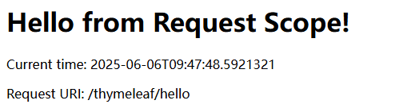

### thymeleaf 添加日志框架

thymeleaf 添加日志框架 `logback`。这样 thymeleaf 运行出错时会自动打印日志信息。便于调试。

#### 添加 logback 的 jar 包

我们项目中已经存在 `slf4j-api-2.0.16.jar`。这个是日志门面，还需要一个具体的实现 slf4j 门面的日志框架，`logback`就是一个具体的实现。

首先我们需要引入 logback 的 jar 包，放到 WEB-INF/lib 目录下：

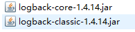

#### 添加 logback 日志框架的配置文件

在类的根路径下新建 `logback.xml`，然后将配置以下内容：

```xml
<configuration>
    <!-- 只输出 ERROR 级别及以上的日志 -->
    <logger name="org.thymeleaf" level="ERROR"/>

    <!-- 关闭 Thymeleaf 初始化 DEBUG 日志 -->
    <logger name="org.thymeleaf.TemplateEngine" level="INFO"/>

    <!-- 控制台输出格式简化 -->
    <appender name="CONSOLE" class="ch.qos.logback.core.ConsoleAppender">
        <encoder>
            <pattern>%d{HH:mm:ss} [%thread] %-5level - %msg%n</pattern>
        </encoder>
    </appender>

    <!-- 全局日志级别设为 WARN -->
    <root level="WARN">
        <appender-ref ref="CONSOLE"/>
    </root>
</configuration>
```

## Thymeleaf 的必要语法

### **基础模板结构（必须掌握）**

```html
<!DOCTYPE html>
<html xmlns:th="http://www.thymeleaf.org">  <!-- 启用Thymeleaf命名空间 -->
<head>
    <title th:text="${pageTitle}">默认标题</title>  <!-- 静态默认值会被动态替换 -->
</head>
<body>
    <!-- 所有Thymeleaf属性以 th: 开头 -->
</body>
</html>
```

**关键点**：

* `th:` 命名空间声明
* 静态内容作为默认值（直接打开HTML文件可预览）

### **变量表达式（90%场景使用）**

```html
<div th:text="${user.name}">用户名默认值</div>  <!-- 即使是一段HTML代码，也只是当做普通文本处理，转义，防止XSS攻击 -->
<div th:utext="${htmlContent}">HTML内容</div>  <!-- 对HTML代码解释执行，不转义，存在XSS攻击风险，谨慎使用 -->
```

### **条件判断（if/unless）**

和 `if/else`不一样。两个是独立的，没有关系。

* 对于 `th:if`来说，为 `true`时显示元素。
* 对于 `th:unless`来说，为 `false`时显示元素。

```html
<div th:if="${user.isAdmin}">管理员可见</div>
<div th:unless="${user.isGuest}">非访客可见</div>
```

### 关于 if 的小细节

有这样一个 VO（View Object：视图对象，负责专门在页面上展示数据的对象）UserVO，代码如下：

```java
package com.jkweilai.thymeleaf.model.vo;

public class UserVO {
    private String username;
    private Boolean isAdmin; // 注意这个属性哈。

    public UserVO() {
    }

    public UserVO(String username, Boolean isAdmin) {
        this.username = username;
        this.isAdmin = isAdmin;
    }

    public String getUsername() {
        return username;
    }

    public void setUsername(String username) {
        this.username = username;
    }

    public Boolean getAdmin() { // isAdmin 属性生成的get方法不是getIsAdmin()，而是getAdmin()。
        return isAdmin;
    }

    public void setAdmin(Boolean admin) {
        isAdmin = admin;
    }
}
```

在 Servlet 当中创建 UserVO 对象，代码如下：

```java
UserVO user = new UserVO("admin", true);
request.setAttribute("user", user);
```

thymeleaf 的模板文件中是这样写的：

```html
<div th:if="${user.isAdmin}"><span th:text="${user.username}"></span>是管理员</div>
```

测试时出现了以下异常：

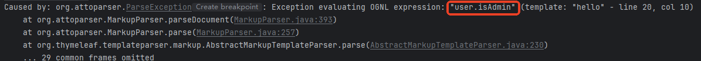

这个问题是因为我们使用了 `${user.isAdmin}`，thymeleaf 底层会去找 `user`对象的 `getIsAdmin()`方法，但是这个方法不存在而导致的。针对这个问题，有多种解决方案，最直接的方式是将模板文件中的代码修改一下，修改为：

```html
<div th:if="${user.admin}"><span th:text="${user.username}"></span>是管理员</div>
```

这样就可以访问了。

### **循环遍历（列表渲染）**

```html
<ul>
    <li th:each="item : ${items}" th:text="${item.name}">商品示例</li>
</ul>
```

**关键点**：

* `th:each="item : ${集合}"` 语法
* 循环状态变量：

```html
<li th:each="item,status : ${items}" th:text="|${status.index} ======== ${item.name}|"></li>
```

**<font style="color:#DF2A3F;">双竖线 |...| 的作用是定义 文本字面量表达式（Literal Expressions），它是一种简化字符串拼接的语法。</font>**

**<font style="color:#DF2A3F;">管道符内的内容会被视为一个整体，Thymeleaf 会自动将其拼接成一个字符串，无需手动加引号或 + 连接。</font>**

### **链接与路径（URL生成）**

```html
<a th:href="@{/user/details(id=${userId})}">用户详情</a>
```

**关键点**：

* `@{}` 自动生成上下文路径（避免硬编码）
* 支持参数：`@{/path(param1=${val1}, param2=${val2})}`

### **表单绑定（重点！）**

```html
<form th:action="@{/save}" th:object="${user}" method="post">
    <input type="text" id="username" name="username" th:value="*{username}" placeholder="用户名">
    <input type="submit" value="保存">
</form>
```

**关键点**：

* `th:object` 绑定表单对象
* `th:value="*{属性名}"`

### **片段复用（布局优化）**

```html
<!-- 定义片段 -->
<div th:fragment="header">
    <h1>公共头部</h1>
</div>

<!-- 引用片段 -->
<div th:replace="~{::header}"></div>  <!-- header片段的定义如果在当前文件中的话，使用这种语法。 -->

<div th:replace="~{commons :: header}"></div>  <!-- 这种语法表示引入commons.html中定义的header片段。 -->
```

**关键点**：

* `th:fragment` 定义可复用块
* `th:replace` 直接替换当前标签

### **实用工具函数（选学）**

```html
<p th:text="${#strings.toUpperCase(user.name)}"></p>  <!-- 字符串大写 -->
<p th:text="${#dates.format(now, 'yyyy-MM-dd')}"></p>  <!-- 日期格式化 -->
```

**工具类**：

* `#strings`、`#numbers`、`#dates`、`#lists`等。

工具函数的具体使用，可以参考 thymeleaf 的官方帮助文档，按照以下步骤查找帮助：

首页面点 `Docs`：

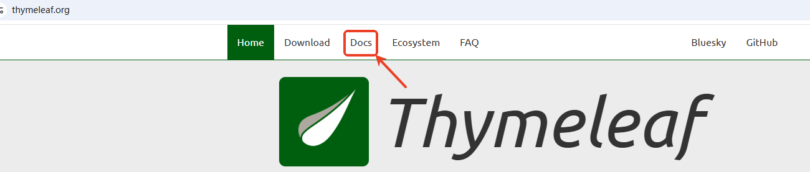

`Read online`在线阅读，或者下载 `PDF`等：

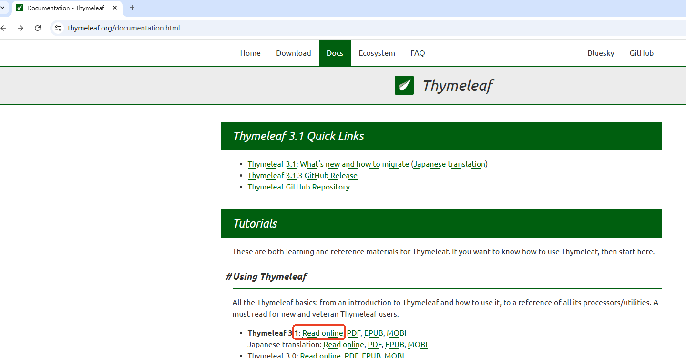

在以下页面中搜索，例如搜索 `#strings`：

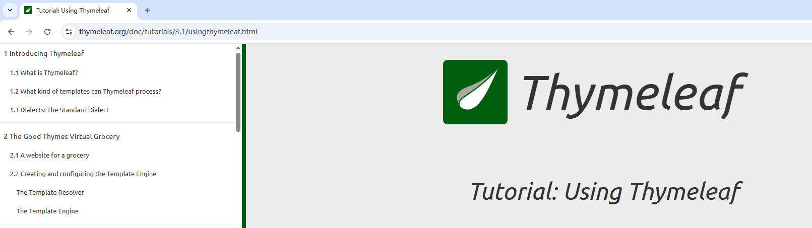

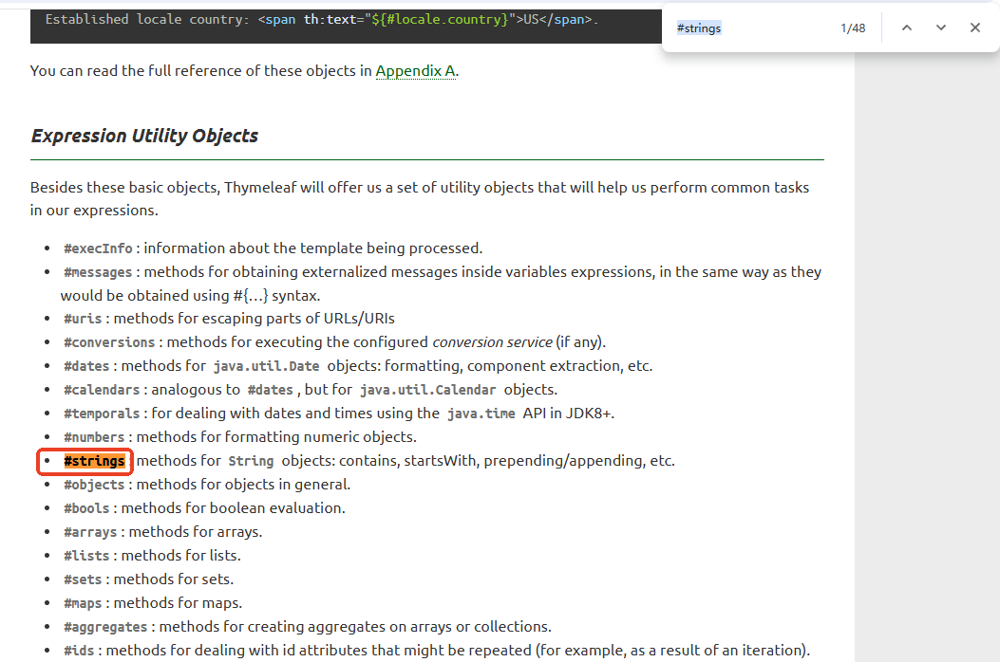

## Thymeleaf 变量查找顺序

<font style="color:rgb(64, 64, 64);">当 </font><code>**<font style="color:rgb(64, 64, 64);background-color:rgb(236, 236, 236);">${message}</font>**</code><font style="color:rgb(64, 64, 64);"> 被解析时，Thymeleaf 会按以下顺序查找：</font>

1. <code>**<font style="color:rgb(64, 64, 64);background-color:rgb(236, 236, 236);">WebContext</font>**</code>**<font style="color:rgb(64, 64, 64);"> 显式设置的变量</font>**<font style="color:rgb(64, 64, 64);">（</font><code>**<font style="color:rgb(64, 64, 64);background-color:rgb(236, 236, 236);">ctx.setVariable("message", "WebContext message")</font>**</code><font style="color:rgb(64, 64, 64);">）</font>
2. <code>**<font style="color:rgb(64, 64, 64);background-color:rgb(236, 236, 236);">HttpServletRequest</font>**</code>**<font style="color:rgb(64, 64, 64);"> 属性</font>**<font style="color:rgb(64, 64, 64);">（</font><code>**<font style="color:rgb(64, 64, 64);background-color:rgb(236, 236, 236);">request.setAttribute("message", "request message")</font>**</code><font style="color:rgb(64, 64, 64);">）</font>

<font style="color:rgb(64, 64, 64);">同名变量时，高优先级的会覆盖低优先级的。</font>

## <font style="color:rgb(64, 64, 64);">Thymeleaf 的其他取值</font>

1. <code>**<font style="color:rgb(64, 64, 64);background-color:rgb(236, 236, 236);">HttpSession</font>**</code>**<font style="color:rgb(64, 64, 64);"> 属性</font>**<font style="color:rgb(64, 64, 64);">（</font><code>**<font style="color:rgb(64, 64, 64);background-color:rgb(236, 236, 236);">session.setAttribute("message", "session message")</font>**</code><font style="color:rgb(64, 64, 64);">），从 session 中取值需要这样写：</font><code><font style="color:rgb(64, 64, 64);">${session.message}</font></code>
2. <code>**<font style="color:rgb(64, 64, 64);background-color:rgb(236, 236, 236);">ServletContext</font>**</code>**<font style="color:rgb(64, 64, 64);"> 全局属性</font>**<font style="color:rgb(64, 64, 64);">（</font><code>**<font style="color:rgb(64, 64, 64);background-color:rgb(236, 236, 236);">servletContext.setAttribute("message", "application message")</font>**</code><font style="color:rgb(64, 64, 64);">），从 application 中取值需要这样写：</font><code><font style="color:rgb(64, 64, 64);">${application.message}</font></code>
3. **<font style="color:rgb(64, 64, 64);">请求参数</font>**<font style="color:rgb(64, 64, 64);">（</font><code>**<font style="color:rgb(64, 64, 64);background-color:rgb(236, 236, 236);">request.getParameter("message")</font>**</code><font style="color:rgb(64, 64, 64);">），从查询参数中取值需要这样写：</font><code><font style="color:rgb(64, 64, 64);">${param.message}</font></code>
4. <code>**<font style="color:rgb(64, 64, 64);background-color:rgb(236, 236, 236);">th:with</font>**</code>**<font style="color:rgb(64, 64, 64);"> </font>\*\*\*\*<font style="color:rgb(64, 64, 64);">局部变量</font>**<font style="color:rgb(64, 64, 64);">（仅限当前作用域）</font>

```html
<div th:with="message='Local Message'">
    <span th:text="${message}"></span> <!-- 输出 "Local Message" -->
</div>
```

## Thymeleaf 的内联 JavaScript 语法

```html
<!-- script脚本中使用Thymeleaf语法需要在script标签上添加 th:inline="javascript" -->
<script th:inline="javascript">
  // Thymeleaf的内联JavaScript语法
  // 也就是说：/*[[这里可以编写thymeleaf的语法]]*/
  let contextPath = /*[[@{/}]]*/ "";
  function deleteByDeptno(elt){
    let deptno = elt.getAttribute("data-deptno");
    if(confirm("您确定删除数据吗？")){
      document.location.href = contextPath + "deleteByNo?deptno=" + deptno;
    }
  }
</script>
```

# 演练1，Servlet整合Thymeleaf

## 1.新建一个web13模块，添加web支持，创建构件

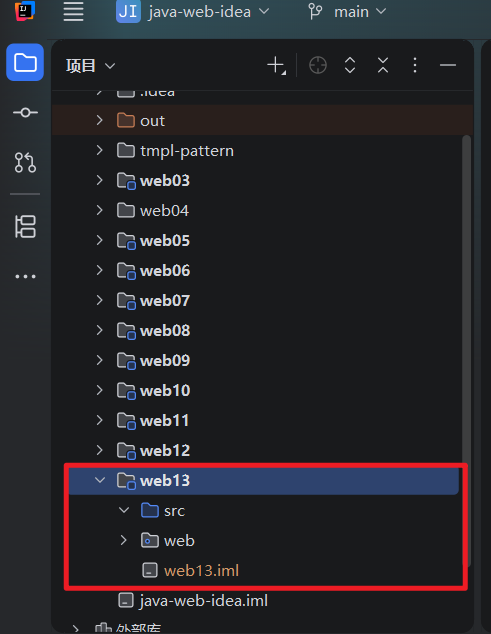

## 2.在模块根目录下面创建一个lib把servlet-api.jar粘贴过来，然后作为库添加到classpath

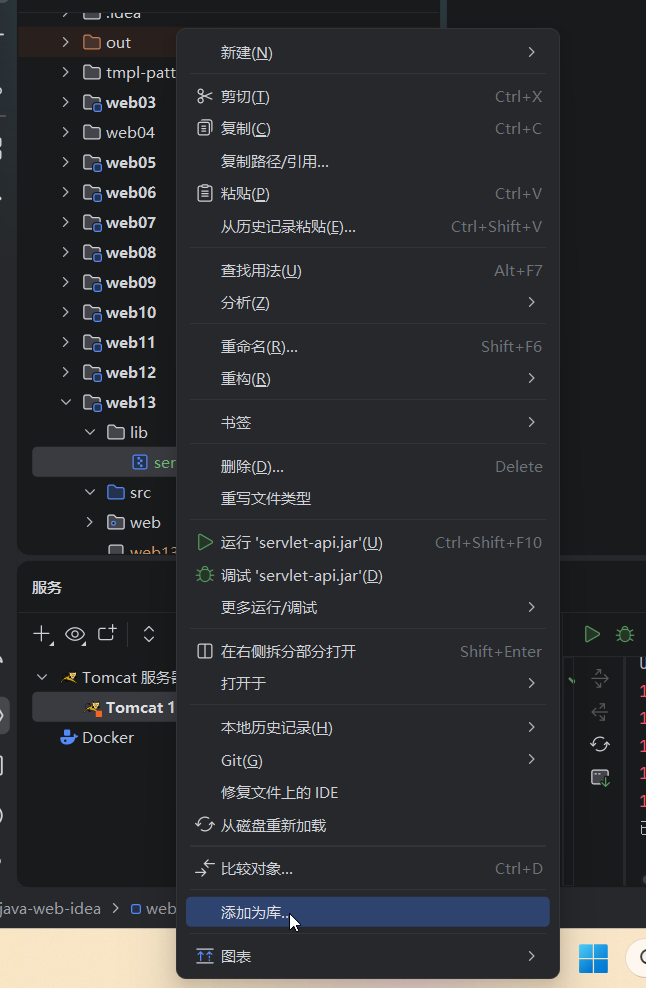

## 3.把项目部署到服务器

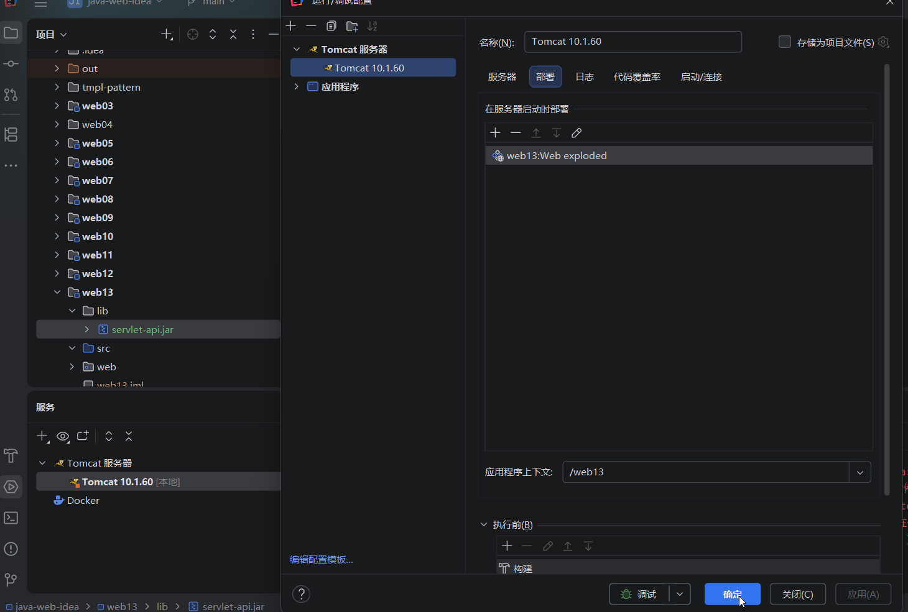

## 4.在web文件夹里面的WEB-INF文件夹里面新建一个lib文件夹，然后把我们需要的jar包粘贴进来

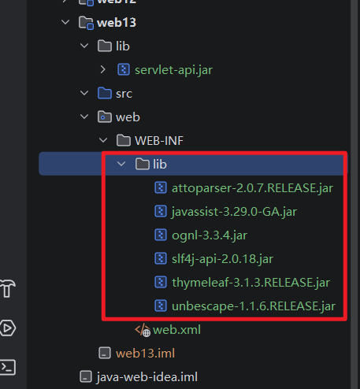

## 5.在themeleaf-3.1.3.RELEASE.jar上面点击右键-》添加为库，把它添加到classpath中

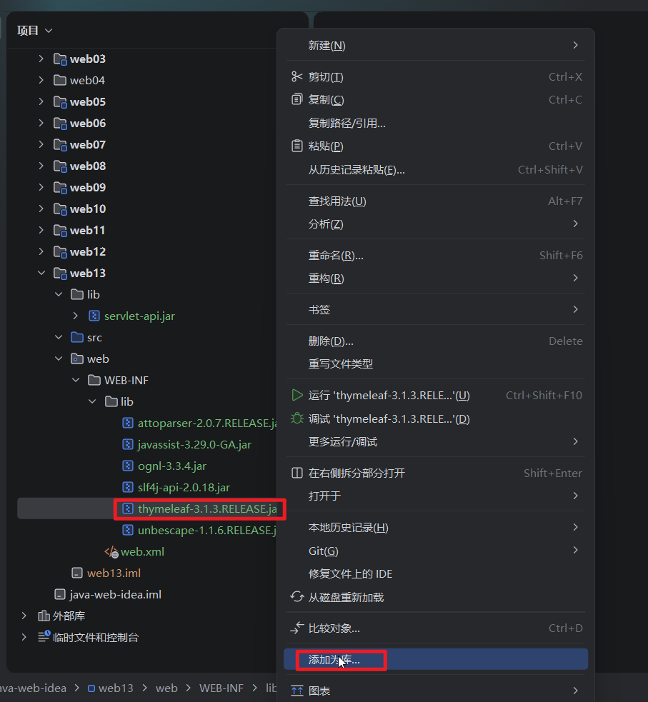

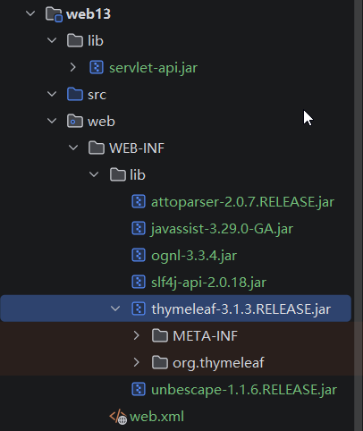

## 6.然后我们需要创建一个ServletContextListener监听器，在里面初始化thymeleaf模板引擎，

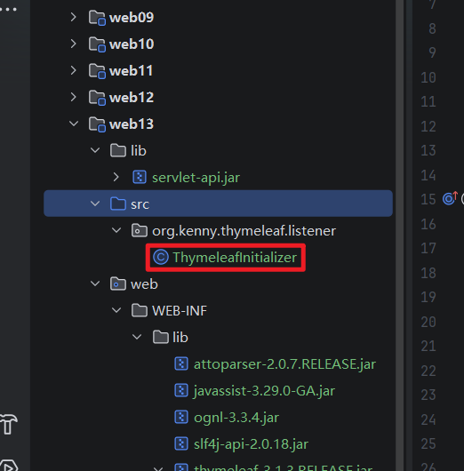

## 内容如下

```
package org.kenny.thymeleaf.listener;

import jakarta.servlet.ServletContext;
import jakarta.servlet.ServletContextEvent;
import jakarta.servlet.ServletContextListener;
import jakarta.servlet.annotation.WebListener;
import org.thymeleaf.TemplateEngine;
import org.thymeleaf.templatemode.TemplateMode;
import org.thymeleaf.templateresolver.WebApplicationTemplateResolver;
import org.thymeleaf.web.servlet.JakartaServletWebApplication;

@WebListener
public class ThymeleafInitializer implements ServletContextListener {
    @Override
    public void contextInitialized(ServletContextEvent sce) {
        //获取ServletContext对象
        ServletContext application = sce.getServletContext();
        //创建Thymeleaf和servlet的适配器，处理web请求
        JakartaServletWebApplication jakartaServletWebApplication = JakartaServletWebApplication.buildApplication(application);
        //用适配器作为参数创建模板解析器
        WebApplicationTemplateResolver templateResolver = new WebApplicationTemplateResolver(jakartaServletWebApplication);
        //设置模板文件的基础存放路径
        templateResolver.setPrefix("/WEB-INF/templates/");
        //设置模板文件的后缀名
        templateResolver.setSuffix(".html");
        //启动html语法支持
        templateResolver.setTemplateMode(TemplateMode.HTML);
        //禁用模板缓存，目的是可以快速看到效果
        templateResolver.setCacheable(false);
        //创建模板引擎
        TemplateEngine templateEngine = new TemplateEngine();
        //关联模板解析器
        templateEngine.setTemplateResolver(templateResolver);
        // 把适配器保存到ServletContext，供后续请求使用
         application.setAttribute("jakartaServletWebApplication", jakartaServletWebApplication);
        // 模板引擎保存到ServletContext，供后续请求使用
        application.setAttribute("templateEngine", templateEngine);

    }

    @Override
    public void contextDestroyed(ServletContextEvent sce) {

    }
}

```

### 注意：这个代码貌似很长，但是他的核心就是3步骤，创建模板适配器，创建模板解析器，创建模板引擎

## 7.然后我们根据上面的配置，在WEB-INF文件夹里面新建一个templates文件夹，然后我们创建一个index.html模板文件

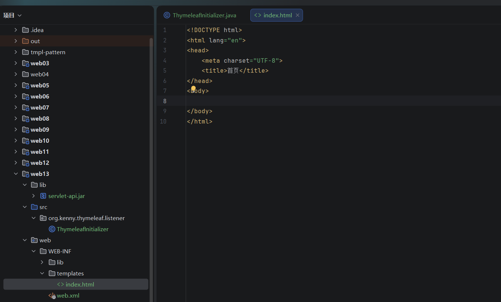

## 8.然后我们需要在html标签里面引入th命名空间映射

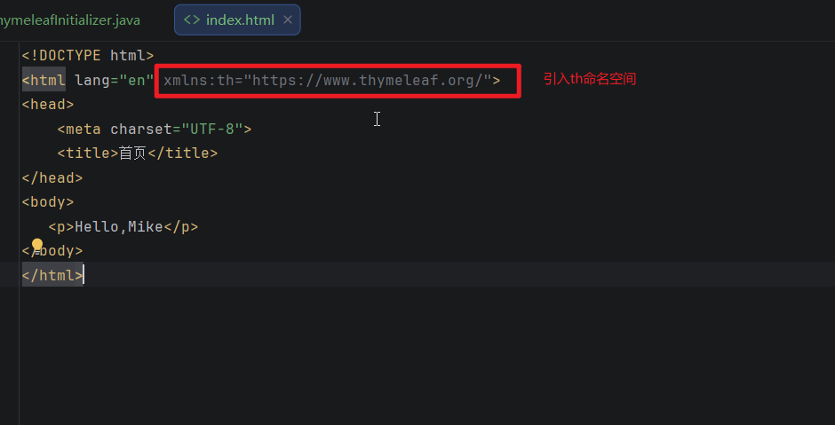

## 9.然后给p标签添加th:text属性，在里面使用一个变量username,我们需要在后端传递这个值。

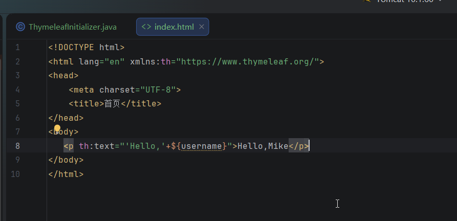

## 10.然后我们来编写一个HelloServlet，在这里渲染index模板文件

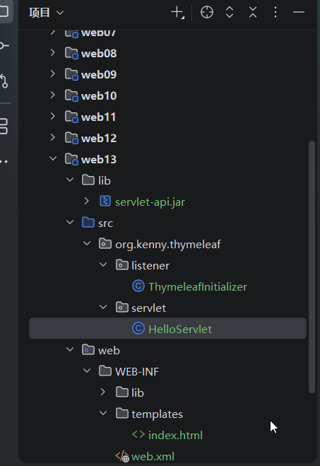

### 代码如下

```
package org.kenny.thymeleaf.servlet;

import jakarta.servlet.ServletContext;
import jakarta.servlet.ServletException;
import jakarta.servlet.annotation.WebServlet;
import jakarta.servlet.http.HttpServlet;
import jakarta.servlet.http.HttpServletRequest;
import jakarta.servlet.http.HttpServletResponse;
import org.thymeleaf.TemplateEngine;
import org.thymeleaf.context.WebContext;
import org.thymeleaf.web.servlet.JakartaServletWebApplication;

import java.io.IOException;

@WebServlet("/hello")
public class HelloServlet extends HttpServlet {
    @Override
    protected void doGet(HttpServletRequest req, HttpServletResponse resp) throws ServletException, IOException {
           //1.往请求域中绑定数据(也可以设置到WebContext对象中)
           req.setAttribute("username", "Benny");
           //2.设置响应编码
           resp.setContentType("text/html;charset=utf-8");
           //3/渲染模板文件
           ServletContext application = getServletContext();
           //3.1 从应用程序域中获取jakartaServletWebApplication对象
           JakartaServletWebApplication jakartaServletWebApplication =
                (JakartaServletWebApplication) application.getAttribute("jakartaServletWebApplication");
          //           System.out.println(jakartaServletWebApplication);
           //3.2 从应用程序域中获取templateEngine对象
           TemplateEngine templateEngine = (TemplateEngine) application.getAttribute("templateEngine");
           //创建Thymeleaf 的 Web 环境上下文对象WebContext
           WebContext webContext = new WebContext(jakartaServletWebApplication.buildExchange(req,resp),req.getLocale());
           //可以将数据绑定到webContext对象中,这里的值会覆盖请求对象里面设置的值
           //webContext.setVariable("username", "Jack");
           //3.3利用webContext对象来处理、渲染模板文件
           templateEngine.process("index", webContext, resp.getWriter());
    }
}

```

### 启动服务器，在浏览器中输入：http://localhost:8080/web13/hello， 效果如下

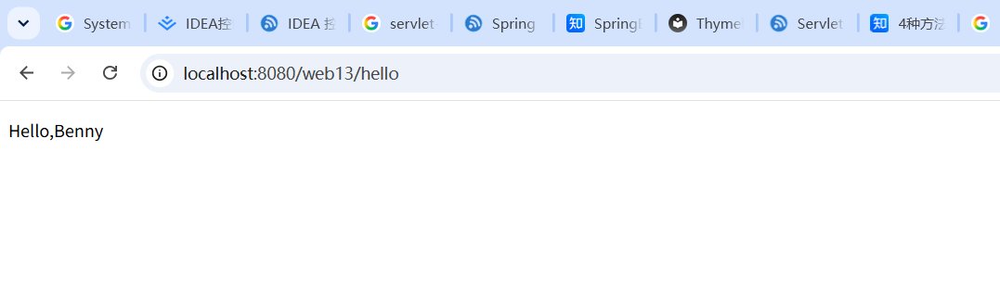

# 演练2.给Thymeleaf封装一个servlet

## 1.新建一个web14项目，然后添加web支持，创建构件

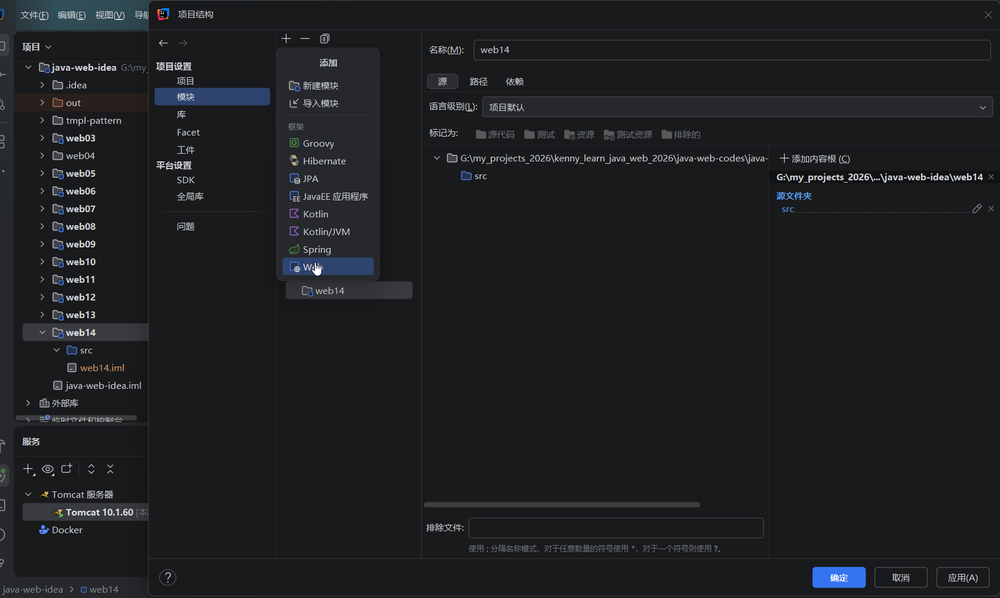

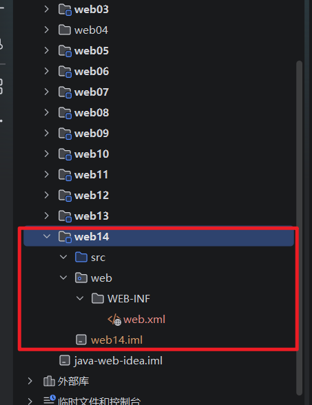

## 2.在模块根目录下面创建一个lib并且把servlet-api.jar粘贴进来，然后在WEB-INF文件夹里面新建一个lib文件夹，把Thymeleaf需要的jar包粘贴进来，然后把servlet-api.jar和themeleaf-3.1.3.RELEASE.jar添加到classpath

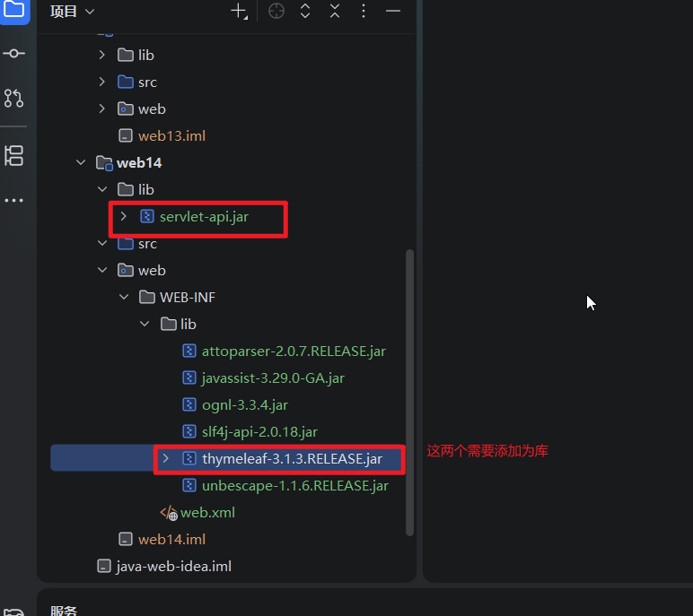

## 3.然后把模块部署到服务器上

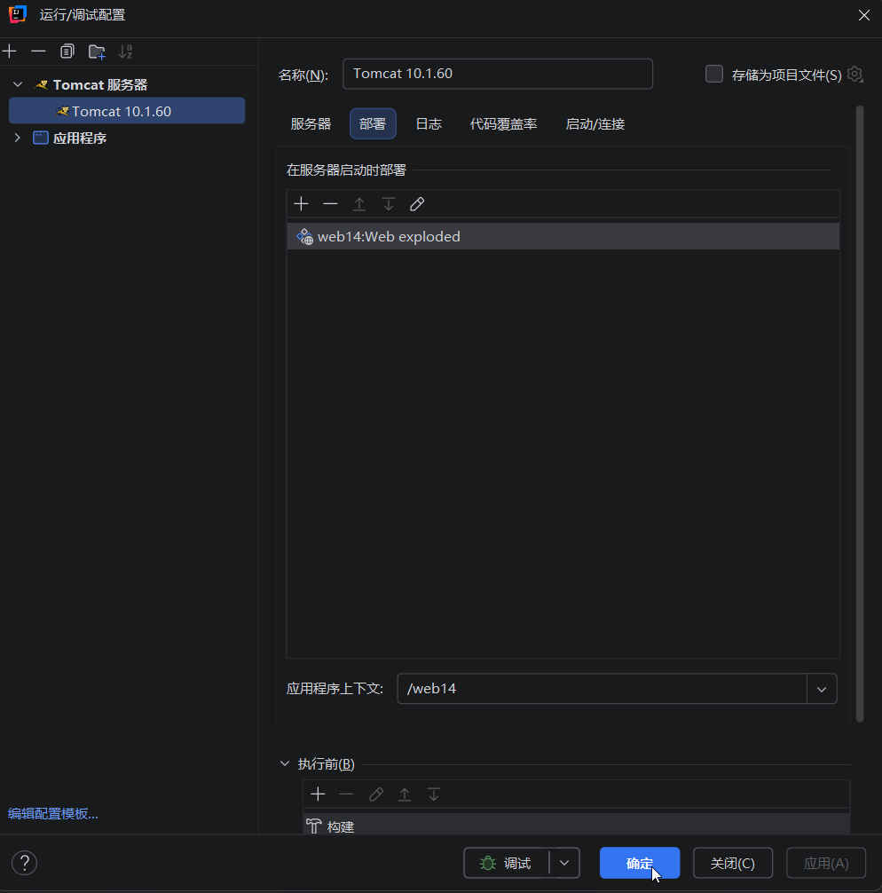

## 4.然后我们新建一个ThymeleafInitializer监听器，实现ServletContextListener接口，内容如下

```
package org.kenny.thymeleaf.listener;

import jakarta.servlet.ServletContext;
import jakarta.servlet.ServletContextEvent;
import jakarta.servlet.ServletContextListener;
import jakarta.servlet.annotation.WebListener;
import org.thymeleaf.TemplateEngine;
import org.thymeleaf.templatemode.TemplateMode;
import org.thymeleaf.templateresolver.WebApplicationTemplateResolver;
import org.thymeleaf.web.servlet.JakartaServletWebApplication;

@WebListener
public class ThymeleafInitializer implements ServletContextListener {
    @Override
    public void contextInitialized(ServletContextEvent sce) {
        //获取ServletContext对象
        ServletContext application = sce.getServletContext();
//        System.out.println(application);//ok
        //创建Thymeleaf和servlet的适配器，处理web请求
        JakartaServletWebApplication jakartaServletWebApplication = JakartaServletWebApplication.buildApplication(application);
//        System.out.println(jakartaServletWebApplication); //ok
        //用适配器作为参数创建模板解析器
        WebApplicationTemplateResolver templateResolver = new WebApplicationTemplateResolver(jakartaServletWebApplication);
        //设置模板文件的基础存放路径
        templateResolver.setPrefix("/WEB-INF/templates/");
        //设置模板文件的后缀名
        templateResolver.setSuffix(".html");
        //启动html语法支持
        templateResolver.setTemplateMode(TemplateMode.HTML);
        //禁用模板缓存，目的是可以快速看到效果
        templateResolver.setCacheable(false);
        //创建模板引擎
        TemplateEngine templateEngine = new TemplateEngine();
        //关联模板解析器
        templateEngine.setTemplateResolver(templateResolver);
        // 把适配器保存到ServletContext，供后续请求使用
        application.setAttribute("jakartaServletWebApplication", jakartaServletWebApplication);
        // 模板引擎保存到ServletContext，供后续请求使用
        application.setAttribute("templateEngine", templateEngine);

    }

    @Override
    public void contextDestroyed(ServletContextEvent sce) {

    }
}

```

## 5.根据监听器的代码设置，在WEB-INF文件夹里面新建一个templates文件夹，在里面创建一个index.html模板文件，注意添加th命名空间映射

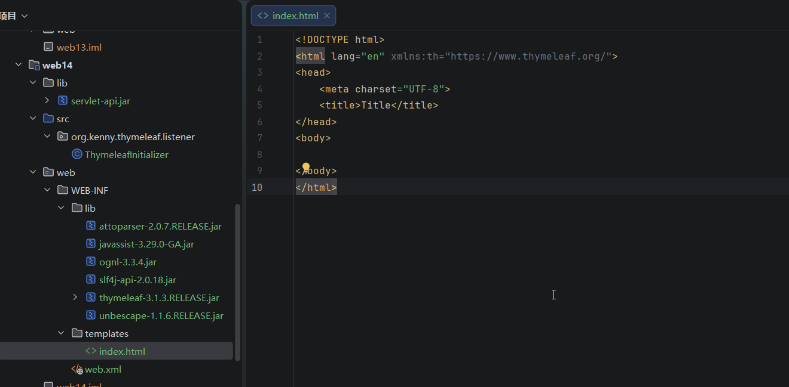

## 6.然后我们修改一下这个模板文件的内容。注意：在thymeleaf中可以用||来左字符串拼接

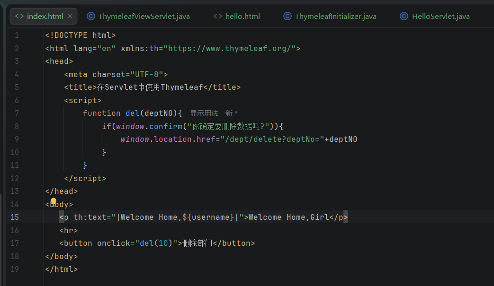

## 7.然后我们编写一个ThymeleafViewServlet,实现doGet和doPost方法

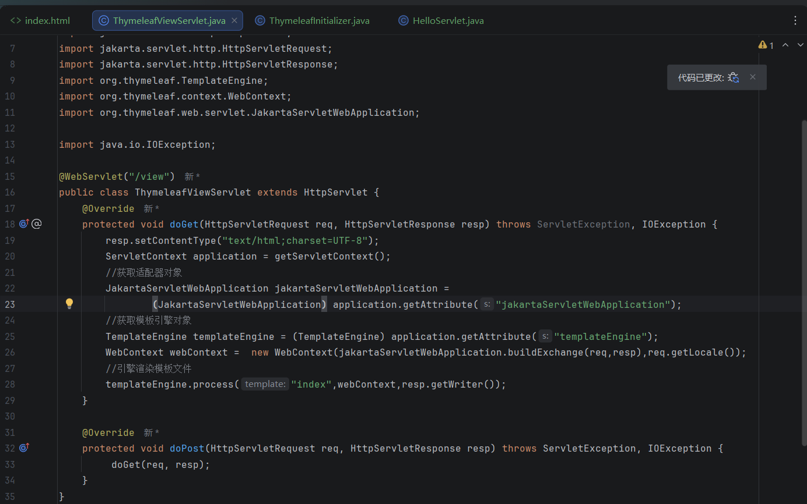

## 8.问题来了，tempalteEngine里面的模板文件能否不要写死，而是使用变量的形式？可以，我们可以从request里面设置它或者可以从查询参数里面获取它，可以使用/view?template=index，当然，还可以使用转发和重定向，修改后代码如下

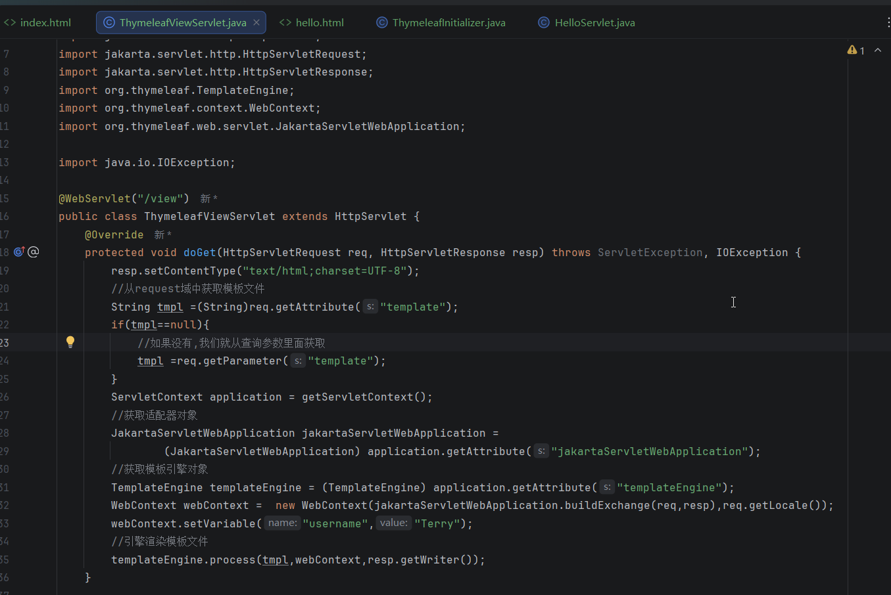

## 9.然后我们创建一个HelloServlet，继承自HttpServlet，实现doGet方法,我们先使用转发，代码如下

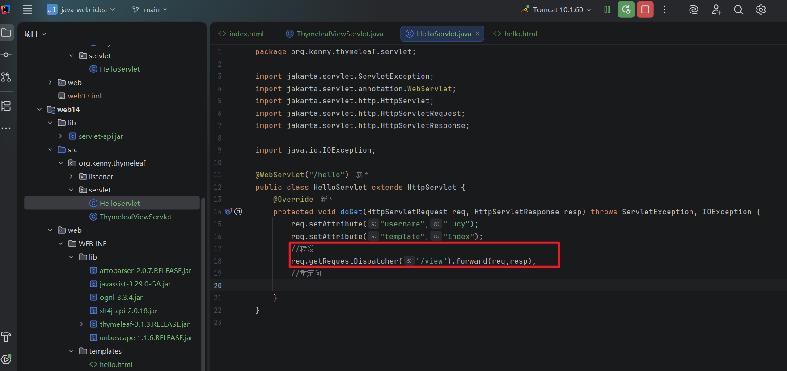

### 启动服务器，在浏览器在输入： http://localhost:8080/web14/hello， 效果如下

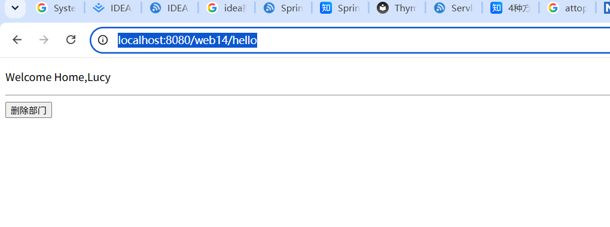

## 10.然后我们来做重定向，注意重定向两个路径的请求对象不是同一个请求对象，此时从请求域中获取不到数据，需要使用查询字符串传递信息

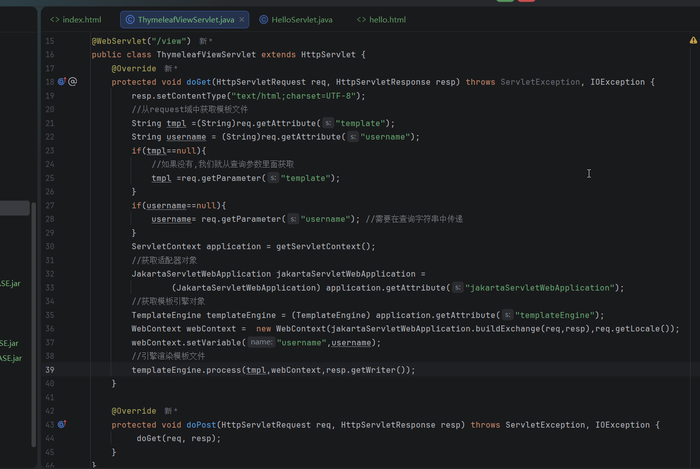

## 11.注意，此时无法获取到username的值，如果需要获取，我们可以修改代码

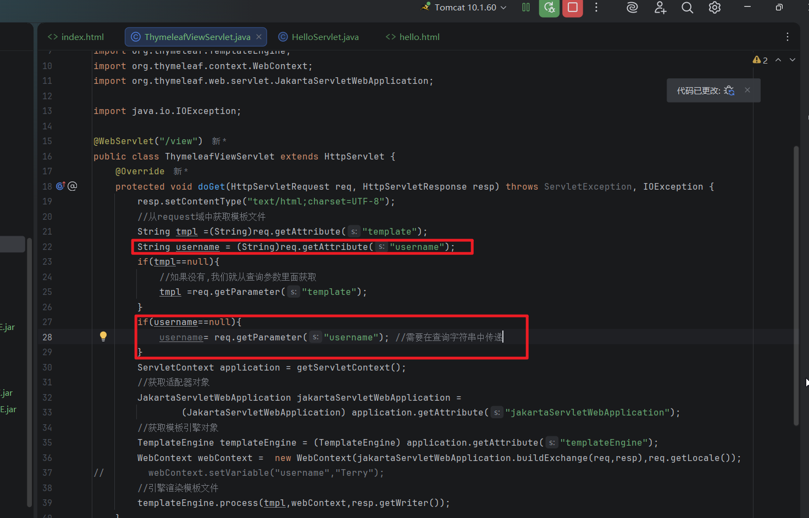

## 12.然后我们修改一下HelloServlet的代码

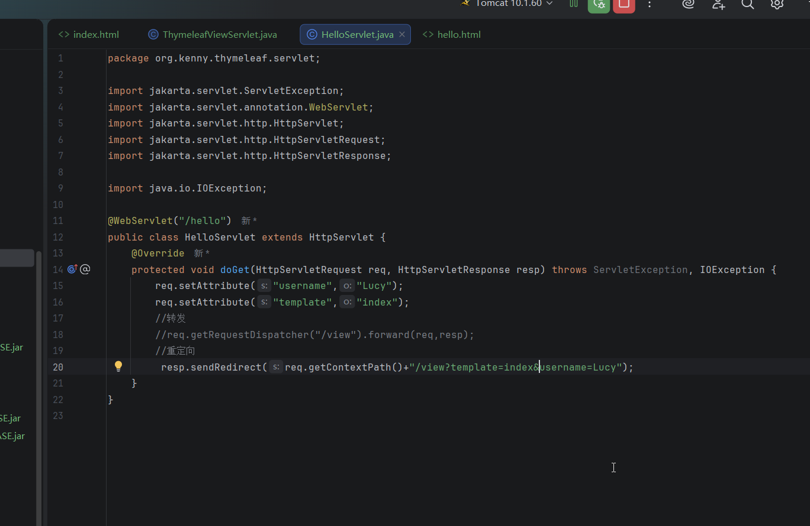

###  这样子就可以获取到了

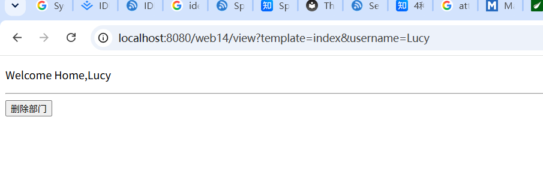

## 13.其实这里是转发好一点，我们这里还是使用转发

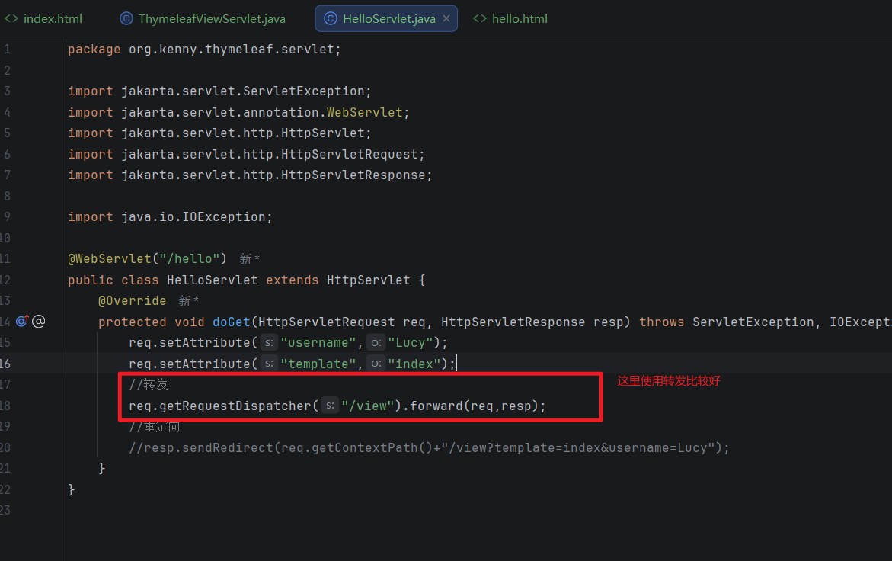

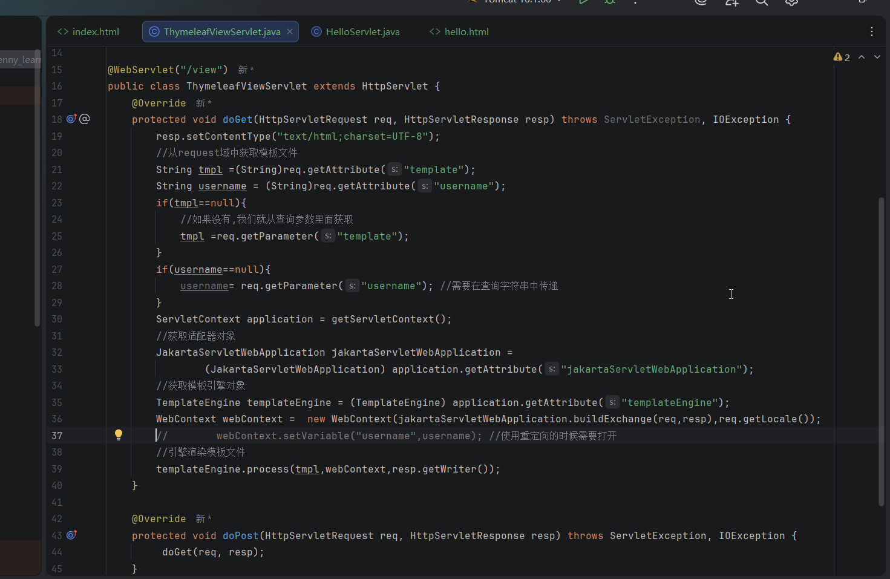
