# 项目结构图参考下图

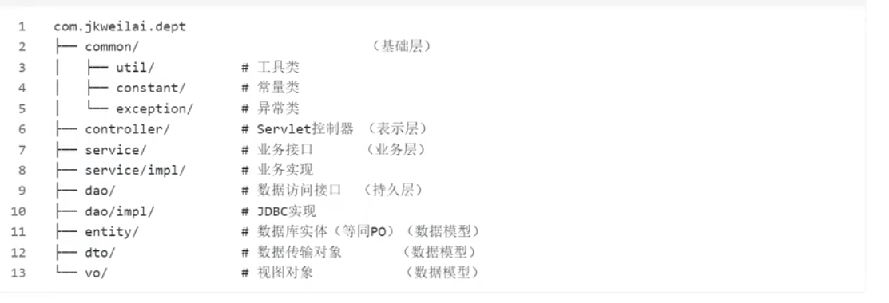

# 实现方式

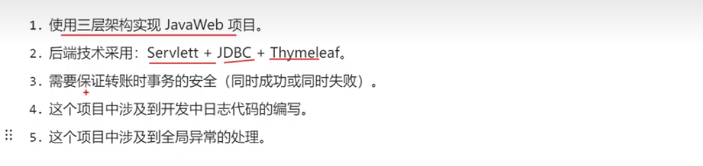

# 1.搭建环境

## 1.数据库和数据表的准备

## 数据库还是使用company数据库

## 数据表

```

drop table if exists t_act;

create table t_act(
  id int primary key auto_increment,
  act_no varchar(255),
  balance decimal(10,1)
);

insert into t_act(act_no,balance) values('6222021234567890123', 50000.0);
insert into t_act(act_no,balance) values('6222021234567890124', 0.0);

drop table if exists t_tran;

CREATE TABLE t_tran (
  id INT PRIMARY KEY AUTO_INCREMENT,
  from_act_no VARCHAR(255) NOT NULL COMMENT '转出账号',
  to_act_no VARCHAR(255) NOT NULL COMMENT '转入账号',
  amount DECIMAL(10,1) NOT NULL COMMENT '转账金额',
  tran_time DATETIME NOT NULL COMMENT '交易时间',
  tran_no VARCHAR(32) NOT NULL COMMENT '交易号',
  INDEX idx_from_act_no (from_act_no),
  INDEX idx_to_act_no (to_act_no),
  INDEX idx_transaction_time (tran_time),
  INDEX idx_transaction_no (tran_no)
) ENGINE=InnoDB DEFAULT CHARSET=utf8mb4 COMMENT='交易记录表';

INSERT INTO t_tran(from_act_no, to_act_no, amount, tran_time, tran_no) VALUES ('6222021234567890123', '6222021234567890124', 1000.0, '2023-11-15 14:30:25', '20231115143025876543');

commit;
select * from t_act;
select * from t_tran;
```

### 打开navicat，选择company数据库，点击新建查询，输入上面的代码，运行就可以创建这两个数据表了

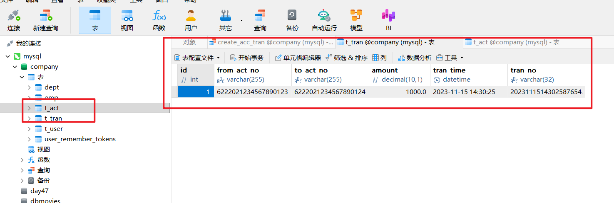

## 2.前端页面的准备

#### 转账页面

```html
<!DOCTYPE html>
<html lang="zh-CN">
<head>
    <meta charset="UTF-8">
    <meta name="viewport" content="width=device-width, initial-scale=1.0">
    <title>银行账户转账</title>
    <style>
        * {
            box-sizing: border-box;
            margin: 0;
            padding: 0;
            font-family: 'Arial', sans-serif;
        }

        body {
            background-color: #f5f7fa;
            display: flex;
            justify-content: center;
            align-items: center;
            min-height: 100vh;
            padding: 20px;
        }

        .container {
            background-color: white;
            border-radius: 10px;
            box-shadow: 0 5px 15px rgba(0, 0, 0, 0.1);
            width: 100%;
            max-width: 500px;
            padding: 30px;
        }

        h1 {
            color: #2c3e50;
            text-align: center;
            margin-bottom: 30px;
            font-size: 24px;
        }

        .form-group {
            margin-bottom: 20px;
        }

        label {
            display: block;
            margin-bottom: 8px;
            color: #34495e;
            font-weight: 600;
        }

        input {
            width: 100%;
            padding: 12px 15px;
            border: 1px solid #ddd;
            border-radius: 6px;
            font-size: 16px;
            transition: border-color 0.3s;
        }

        input:focus {
            border-color: #3498db;
            outline: none;
            box-shadow: 0 0 0 2px rgba(52, 152, 219, 0.2);
        }

        button {
            background-color: #3498db;
            color: white;
            border: none;
            border-radius: 6px;
            padding: 14px;
            width: 100%;
            font-size: 16px;
            font-weight: 600;
            cursor: pointer;
            transition: background-color 0.3s;
            margin-top: 10px;
        }

        button:hover {
            background-color: #2980b9;
        }

        .result {
            margin-top: 20px;
            padding: 15px;
            border-radius: 6px;
            display: none;
        }

        .success {
            background-color: #d4edda;
            color: #155724;
            border: 1px solid #c3e6cb;
        }

        .error {
            background-color: #f8d7da;
            color: #721c24;
            border: 1px solid #f5c6cb;
        }

        .hint {
            font-size: 12px;
            color: #7f8c8d;
            margin-top: 5px;
        }
    </style>
</head>
<body>
<div class="container">
    <h1>银行账户转账</h1>

    <form id="transferForm" method="post">
        <div class="form-group">
            <label for="fromAccount">转出账户</label>
            <input type="text" id="fromAccount" placeholder="请输入转出账户号码" required>
            <div class="hint">例如：6222021234567890123</div>
        </div>

        <div class="form-group">
            <label for="toAccount">转入账户</label>
            <input type="text" id="toAccount" placeholder="请输入转入账户号码" required>
            <div class="hint">例如：6228481234567890123</div>
        </div>

        <div class="form-group">
            <label for="amount">转账金额 (元)</label>
            <input type="number" id="amount" min="0.01" step="0.01" placeholder="请输入转账金额" required>
        </div>

        <button id="transferBtn">确认转账</button>
    </form>

    <div id="resultMessage" class="result"></div>
</div>

<script>
    document.getElementById('transferBtn').addEventListener('click', function(e) {
        e.preventDefault();
        const fromAccount = document.getElementById('fromAccount').value.trim();
        const toAccount = document.getElementById('toAccount').value.trim();
        const amount = parseFloat(document.getElementById('amount').value);

        // 简单验证
        if (!fromAccount || !toAccount || isNaN(amount) || amount <= 0) {
            showResult('请填写完整的转账信息，且金额必须大于0', false);
            return;
        }

        // 验证账户格式（简单验证是否为数字）
        if (!/^\d+$/.test(fromAccount) || !/^\d+$/.test(toAccount)) {
            showResult('账户号码必须为数字', false);
            return;
        }

        // 账户长度验证（通常银行账号16-19位）
        if (fromAccount.length < 16 || fromAccount.length > 19 ||
            toAccount.length < 16 || toAccount.length > 19) {
            showResult('账户号码长度应在16-19位之间', false);
            return;
        }

        if (fromAccount === toAccount) {
            showResult('转出账户和转入账户不能相同', false);
            return;
        }

        // 提交表单
        document.getElementById("transferForm").submit();
    });

    function showResult(message, isSuccess) {
        const resultMessage = document.getElementById('resultMessage');
        resultMessage.textContent = message;
        resultMessage.className = 'result ' + (isSuccess ? 'success' : 'error');
        resultMessage.style.display = 'block';
        // 5秒后自动隐藏消息
        setTimeout(() => {
            resultMessage.style.display = 'none';
        }, 5000);
    }
</script>
</body>
</html>
```

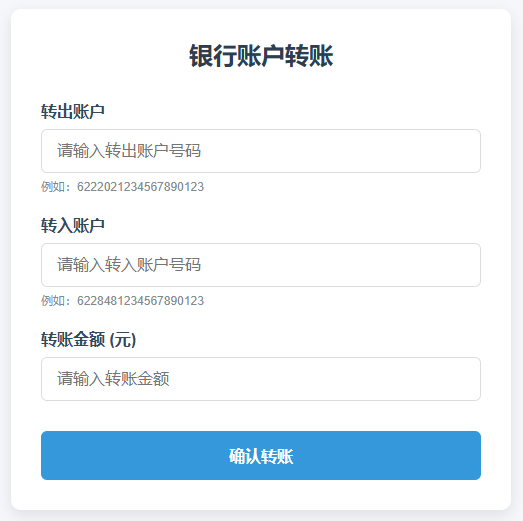

#### 转账成功页面

```html
<!DOCTYPE html>
<html lang="zh-CN">
<head>
    <meta charset="UTF-8">
    <meta name="viewport" content="width=device-width, initial-scale=1.0">
    <title>转账结果</title>
    <style>
        * {
            box-sizing: border-box;
            margin: 0;
            padding: 0;
            font-family: 'Arial', sans-serif;
        }
        
        body {
            background-color: #f5f7fa;
            display: flex;
            justify-content: center;
            align-items: center;
            min-height: 100vh;
            padding: 20px;
        }
        
        .container {
            background-color: white;
            border-radius: 10px;
            box-shadow: 0 5px 15px rgba(0, 0, 0, 0.1);
            width: 100%;
            max-width: 500px;
            padding: 30px;
            text-align: center;
        }
        
        h1 {
            color: #2c3e50;
            margin-bottom: 30px;
            font-size: 24px;
        }
        
        .status-icon {
            font-size: 60px;
            margin-bottom: 20px;
            color: #2ecc71;
        }
        
        .detail-card {
            background-color: #f8f9fa;
            border-radius: 8px;
            padding: 20px;
            margin-bottom: 15px;
            text-align: left;
        }
        
        .detail-row {
            display: flex;
            justify-content: space-between;
            margin-bottom: 12px;
            padding-bottom: 12px;
            border-bottom: 1px solid #eee;
        }
        
        .detail-row:last-child {
            border-bottom: none;
            margin-bottom: 0;
            padding-bottom: 0;
        }
        
        .detail-label {
            color: #7f8c8d;
            font-weight: 500;
        }
        
        .detail-value {
            color: #2c3e50;
            font-weight: 600;
        }
        
        .amount {
            font-size: 24px;
            color: #e74c3c;
            font-weight: 700;
        }
        
        .transaction-number {
            color: #7f8c8d;
            font-size: 14px;
            margin-bottom: 25px;
        }
        
        .continue-btn {
            background-color: #3498db;
            color: white;
            border: none;
            border-radius: 5px;
            padding: 12px 25px;
            font-size: 16px;
            font-weight: 600;
            cursor: pointer;
            width: 100%;
            transition: background-color 0.3s;
        }
        
        .continue-btn:hover {
            background-color: #2980b9;
        }
    </style>
</head>
<body>
    <div class="container">
        <div class="status-icon">✓</div>
        <h1>转账成功</h1>
        
        <div class="detail-card">
            <div class="detail-row">
                <span class="detail-label">转出账户</span>
                <span class="detail-value">****9012</span>
            </div>
            <div class="detail-row">
                <span class="detail-label">转入账户</span>
                <span class="detail-value">****2333</span>
            </div>
            <div class="detail-row">
                <span class="detail-label">转账金额</span>
                <span class="detail-value amount">￥1,500.00</span>
            </div>
            <div class="detail-row">
                <span class="detail-label">转账时间</span>
                <span class="detail-value">2030-11-15 14:30:25</span>
            </div>
        </div>
        
        <div class="transaction-number">交易流水号：20231115143025876543</div>
        <button class="continue-btn">继续转账</button>
    </div>
</body>
</html>
```

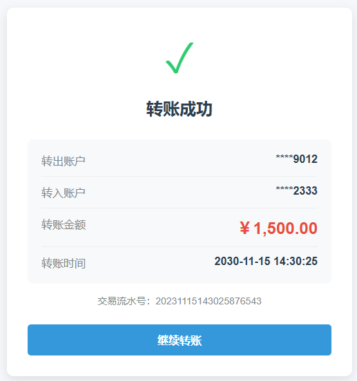

#### 转账失败页面

```html
<!DOCTYPE html>
<html lang="zh-CN">
<head>
    <meta charset="UTF-8">
    <meta name="viewport" content="width=device-width, initial-scale=1.0">
    <title>转账失败</title>
    <style>
        * {
            box-sizing: border-box;
            margin: 0;
            padding: 0;
            font-family: 'Arial', sans-serif;
        }
        
        body {
            background-color: #f5f7fa;
            display: flex;
            justify-content: center;
            align-items: center;
            min-height: 100vh;
            padding: 20px;
        }
        
        .container {
            background-color: white;
            border-radius: 10px;
            box-shadow: 0 5px 15px rgba(0, 0, 0, 0.1);
            width: 100%;
            max-width: 500px;
            padding: 40px;
            text-align: center;
        }
        
        h1 {
            color: #e74c3c;
            margin-bottom: 30px;
            font-size: 28px;
        }
        
        .status-icon {
            font-size: 60px;
            margin-bottom: 25px;
            color: #e74c3c;
        }
        
        .error-message {
            color: #e74c3c;
            font-size: 18px;
            font-weight: 500;
            margin-bottom: 30px;
        }
        
        .continue-btn {
            background-color: #3498db;
            color: white;
            border: none;
            border-radius: 6px;
            padding: 14px;
            width: 100%;
            font-size: 16px;
            font-weight: 600;
            cursor: pointer;
            transition: background-color 0.3s;
        }
        
        .continue-btn:hover {
            background-color: #2980b9;
        }
    </style>
</head>
<body>
    <div class="container">
        <div class="status-icon">✕</div>
        <h1>转账失败</h1>
        <div class="error-message">转账失败原因：账户余额不足</div>
        <button class="continue-btn" onclick="window.location.href='transfer.html'">继续转账</button>
    </div>
</body>
</html>
```

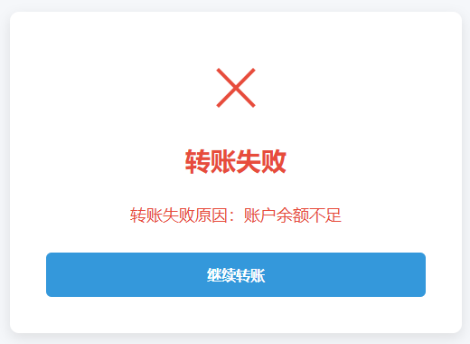

## 3.用idea新建一个模块，起名bank，添加web支持，并且创建工件

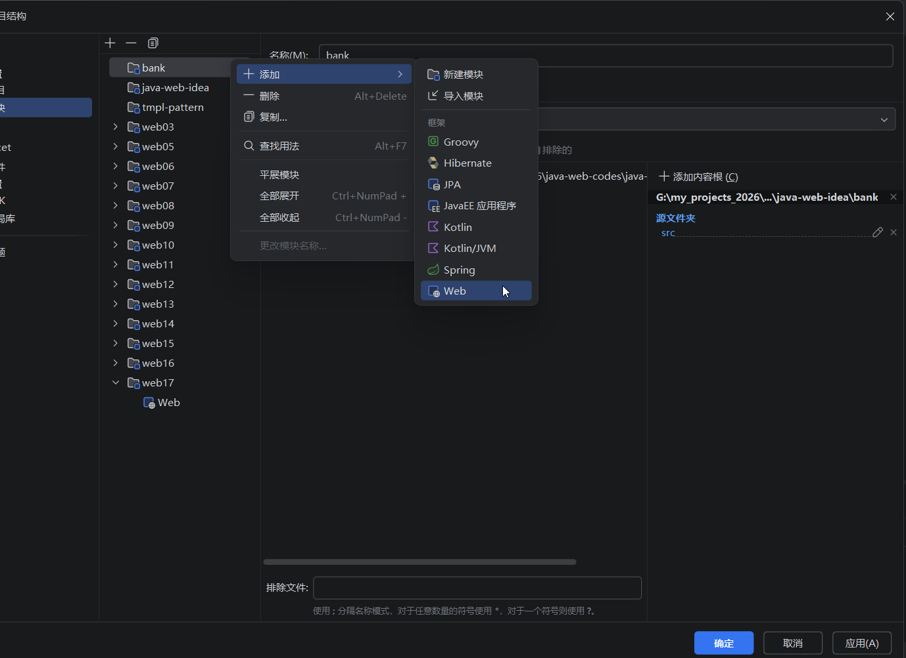

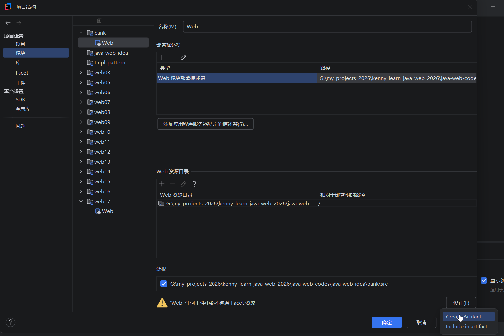

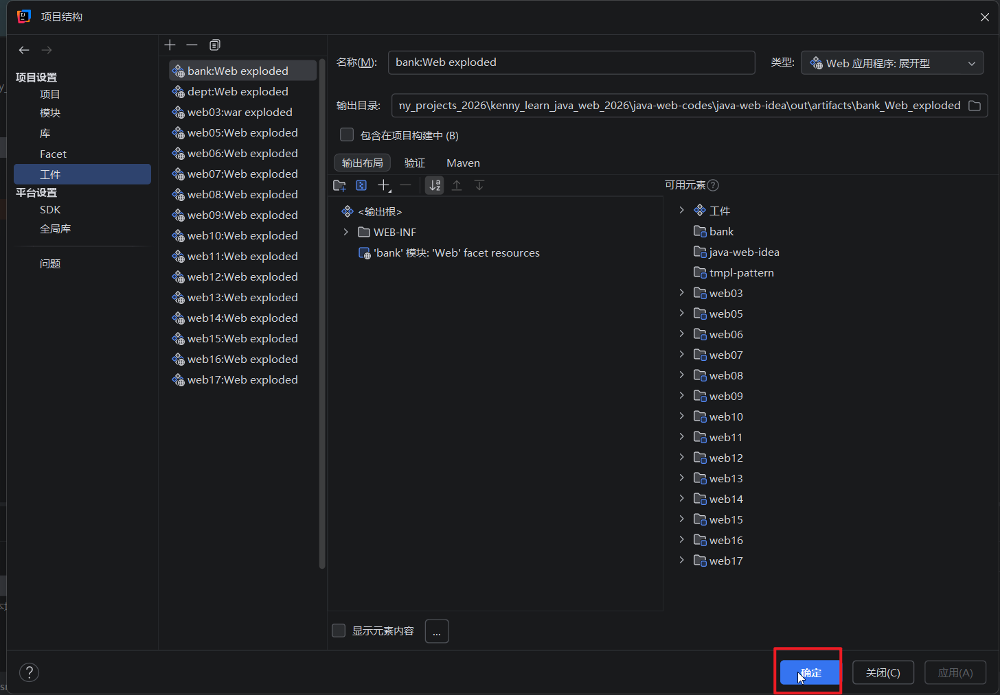

## 4.在模块根目录里面新建一个lib文件夹，把servlet-api.jar粘贴过来，并且添加到classpath

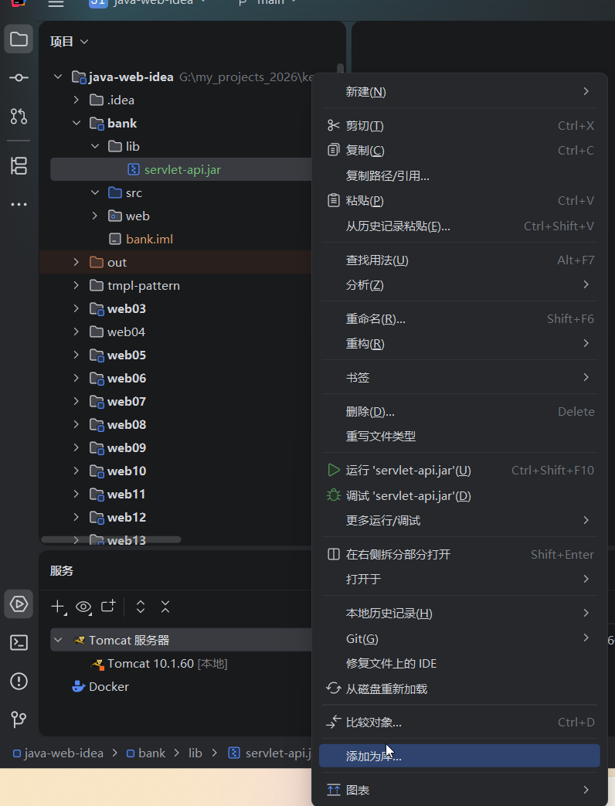

## 5.把我们的模块部署到tomcat

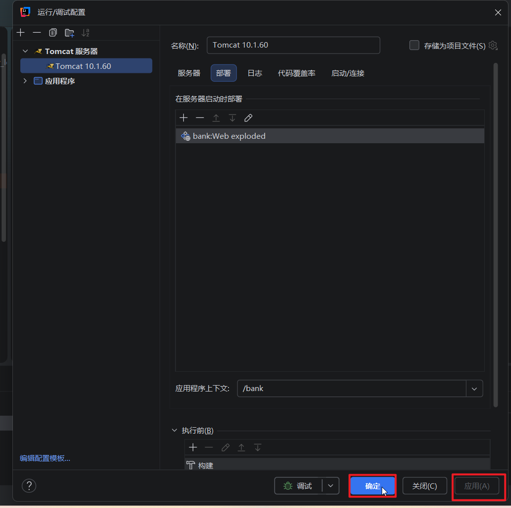

## 6.在网站的根目录下面新建一个lib文件夹，添加mysql的java驱动包和thymeleaf和日志以及一些相关jar包，把bcprov-jdk18on-1.77.jar和thymeleaf-3.1.3.RELEASE.jar和self4j-2.0.18.jar作为库添加到classpath

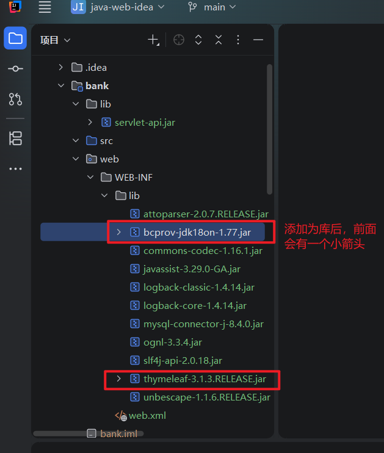

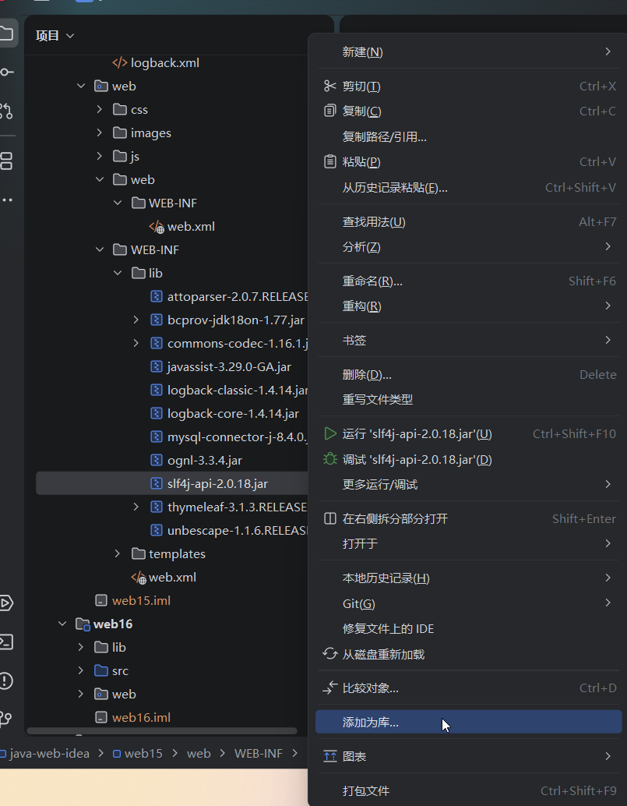

## 7.在src文件夹里面新建一个org.kenny.bank.common.util包，把web15里面的util文件夹里面的文件拷贝粘贴过来

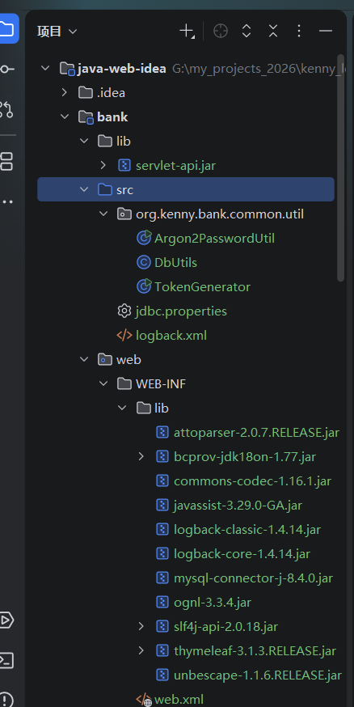

## 8.在src文件夹里面创建一个jdbc.properties文件和一个logback.xml文件

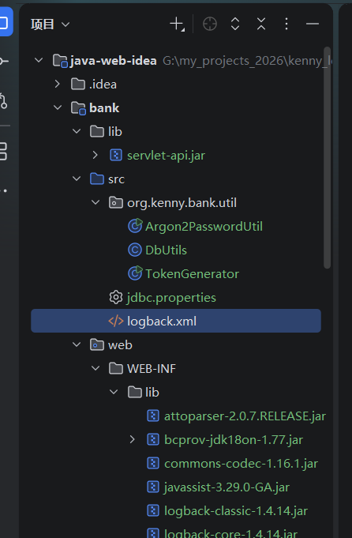

## 9.新建一个listener包，把ThymeleafInitializer监听器类粘贴过来

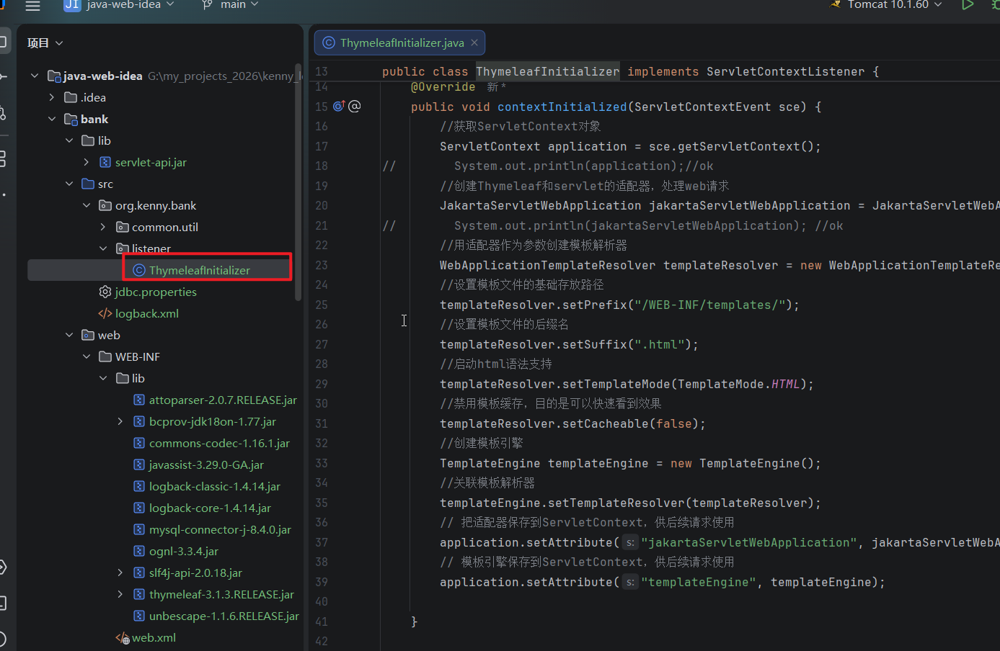

## 10.根据这个类的需要，在WEB-INF里面新建一个templates文件夹，然后创建3个文件index.html,success.html,error.html,分别粘贴转账页面，转账成功页面和转账失败页面的代码

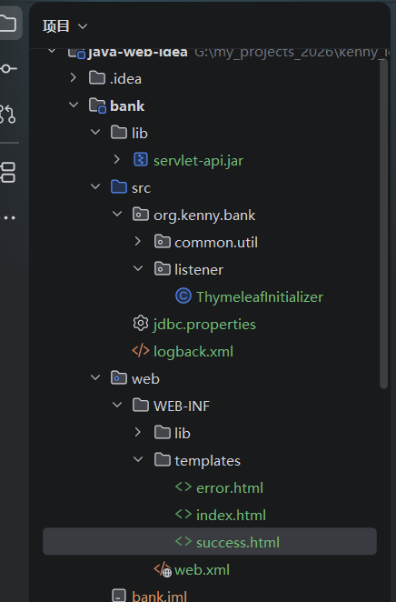

## 注意：需要给他们添加th命名空间引用

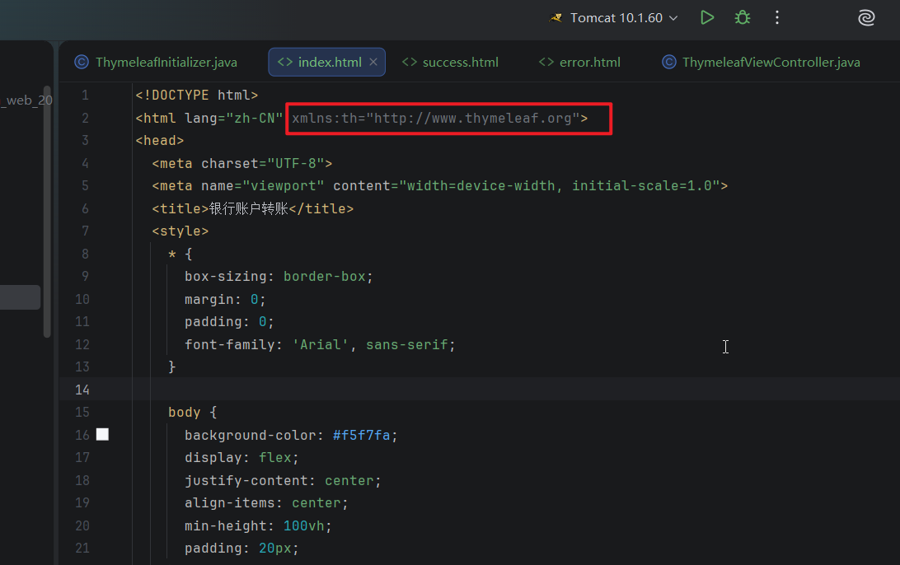

## 11.创建一个controller包，把web15模块的ThymeleafViewServlet粘贴进来

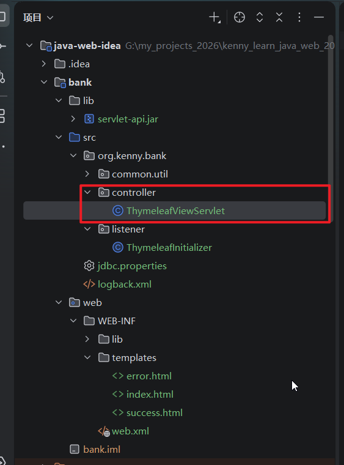

## 然后把他改名ThymeleafViewController

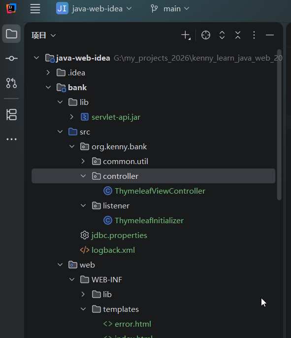

## 12.然后我们需要在controller包里面创建一个IndexController类，继承HttpSerlet，然后实现doGet方法，添加一个/index连接映射

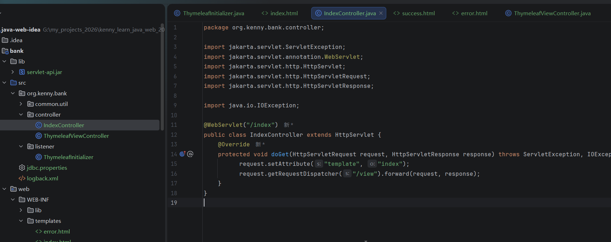

## 13.然后我们需要在模块的网站根里面的WEB-INF/web.xml里面配置欢迎页面

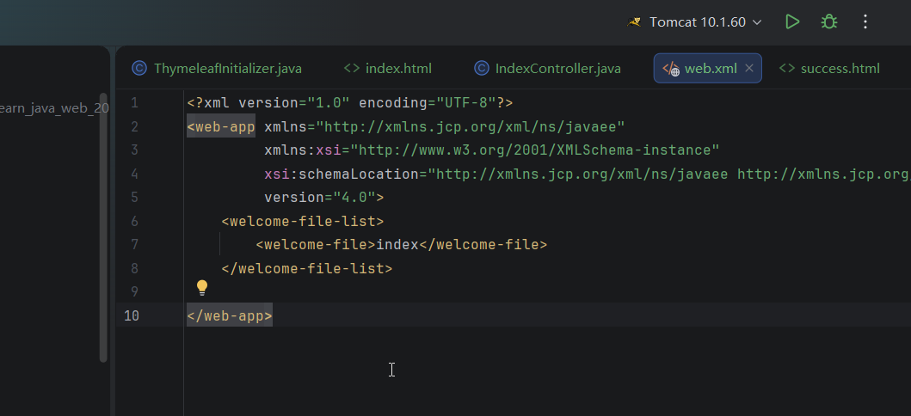

## 14.启动服务器，就会自动进入转账页面

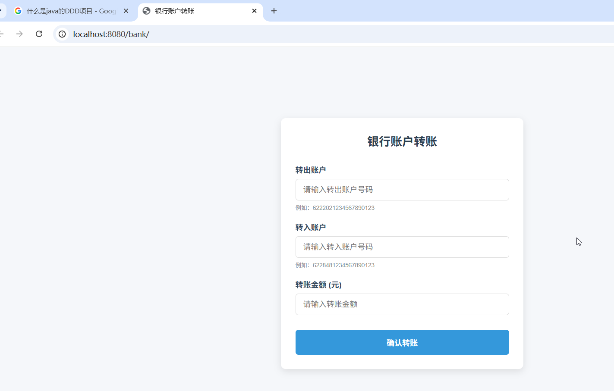

## 项目搭建完成

# 2.添加全局异常处理和日志

## 2.1需要修改logback.xml文件，内容如下

```
<configuration>
    <!-- 控制台输出格式简化 -->
    <appender name="CONSOLE" class="ch.qos.logback.core.ConsoleAppender">
        <encoder>
            <pattern>%d{HH:mm:ss} [%thread] %-5level - %msg%n</pattern>
        </encoder>
    </appender>

    <!-- 错误日志单独文件输出:滚动记录，最多保留7天的日志。 -->
    <appender name="ERROR_FILE" class="ch.qos.logback.core.rolling.RollingFileAppender">
        <file>logs/error.log</file>
        <rollingPolicy class="ch.qos.logback.core.rolling.TimeBasedRollingPolicy">
            <fileNamePattern>logs/error.%d{yyyy-MM-dd}.log</fileNamePattern>
            <maxHistory>7</maxHistory>
        </rollingPolicy>
        <encoder>
            <!--
              记录日志的时间、线程、日志级别、类名（缩写）和消息内容，并换行。
                %d{yyyy-MM-dd HH:mm:ss} 记录日志的时间
                [%thread] 线程名
                %-5level  日志级别，左对齐，留5个字符的空间
                %logger{36}  类名，最多保留36个字符的空间
                %msg 日志消息
                %n 换行
              例如：2026-06-24 18:30:45 [http-nio-8080-exec-1] INFO  com.jkweilai.service.AccountService - 转账成功
            -->
            <pattern>%d{yyyy-MM-dd HH:mm:ss} [%thread] %-5level %logger{36} - %msg%n</pattern>
        </encoder>
    </appender>

    <!-- Thymeleaf相关日志设置：只打印ERROR级别日志，但是给TemplateEngine类开一个小灶，让它能打印INFO级别的日志 -->
    <logger name="org.thymeleaf" level="ERROR"/>
    <logger name="org.thymeleaf.TemplateEngine" level="INFO"/>

    <!-- JDBC日志设置：默认Hikari打印日志太多，设置为WARN，只打印重要日志 -->
    <logger name="java.sql" level="WARN"/>
    <logger name="com.zaxxer.hikari" level="WARN"/>

    <!-- 应用包路径日志设置，可以看到自己写的业务逻辑、控制器、服务类的运行情况 -->
    <logger name="org.kenny" level="INFO"/>

    <!-- 全局日志级别为：全局日志级别设为 WARN，所有日志同时输出到控制台和错误日志文件 -->
    <root level="WARN">
        <appender-ref ref="CONSOLE"/>
        <appender-ref ref="ERROR_FILE"/>
    </root>
</configuration>
```

## 2.2测试一下手动记录日志，可以新建一个test包，在里面创建一个Test类

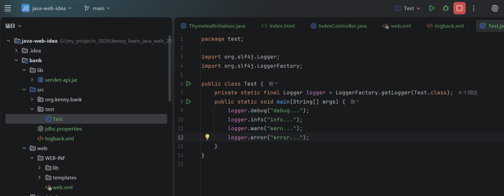 

### 运行程序，报错了，说没有日志提供程序

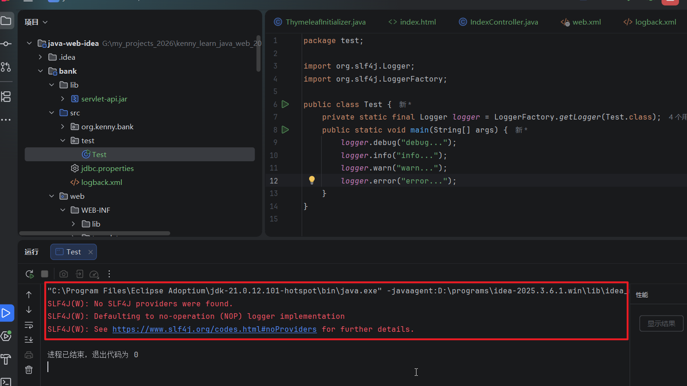

### 那是因为此时已经脱离了tomcat运行，所以就找不到，其实我们现在必要测试，等一下我们在项目里面就可以测试

# 3. 自定义数据库访问异常

## 3.1 在common里面新建一个exception包

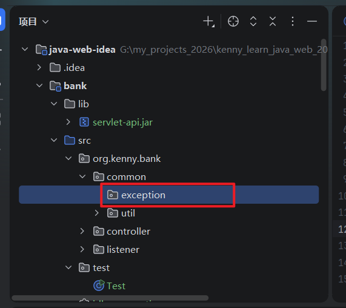

## 3.2 在exception包里面新建有DataAccessException类，

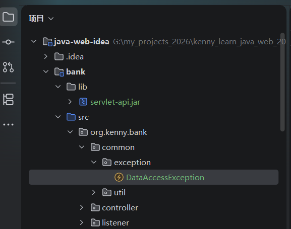

## 我们只需要创建多几个构造函数即可，完整代码如下

```
package org.kenny.bank.common.exception;

//给dao准备的异常类
public class DataAccessException extends RuntimeException
{
	private static final long serialVersionUID = 1L;
    //自定义错误代码
    private String errorCode;

	public DataAccessException()
	{
        super();
    }
    public DataAccessException(String message)
    {
        super(message);
    }
    public DataAccessException(String message, Throwable cause)
    {
        super(message, cause);
    }

    //既有错误代码，又有错误信息
    public DataAccessException(String errorCode,String message)
    {
        super(message); //必须放在第一行
        this.errorCode = errorCode;
    }

    //既有错误代码，又有错误信息，还有原始异常对象
    public DataAccessException(String errorCode,String message,Throwable cause)
    {
        super(message, cause);
        this.errorCode = errorCode;
    }

    public String getErrorCode() {
        return errorCode;
    }
}

```

# 4.自定义全局异常

## 4.1.中exception包里面新建一个BusinessException类，也是继承RuntimeException，

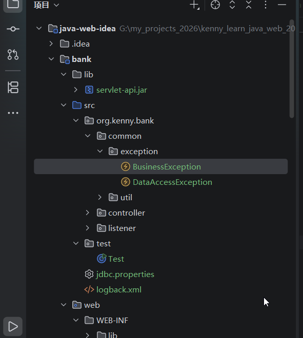

## 代码如下

```
package org.kenny.bank.common.exception;

//给业务层准备的自定义异常类
public class BusinessException extends RuntimeException{

    private String errorCode;

    public BusinessException()
    {

    }
    public BusinessException(String message)
    {
        super(message);
    }
    public BusinessException(String message,Throwable cause)
    {
        super(message,cause);
    }
    public BusinessException(String errorCode,String message)
    {
        super(message);
        this.errorCode = errorCode;
    }
    public BusinessException(String errorCode,String message,Throwable cause)
    {
        super(message,cause);
        this.errorCode = errorCode;
    }

    public String getErrorCode()
    {
        return errorCode;
    }
}

```

## 4.2 然后我们需要编写一个全局的异常处理器，我们需要在controller包里面新建一个类：GlobalExceptionHandler继承自HttpServlet，最好把doGet和doPost都实现，映射路径为：/error-handler


## 4.3 然后我们需要在我们模块里面的web.xml中配置错误处理页面，路径和上面的一样

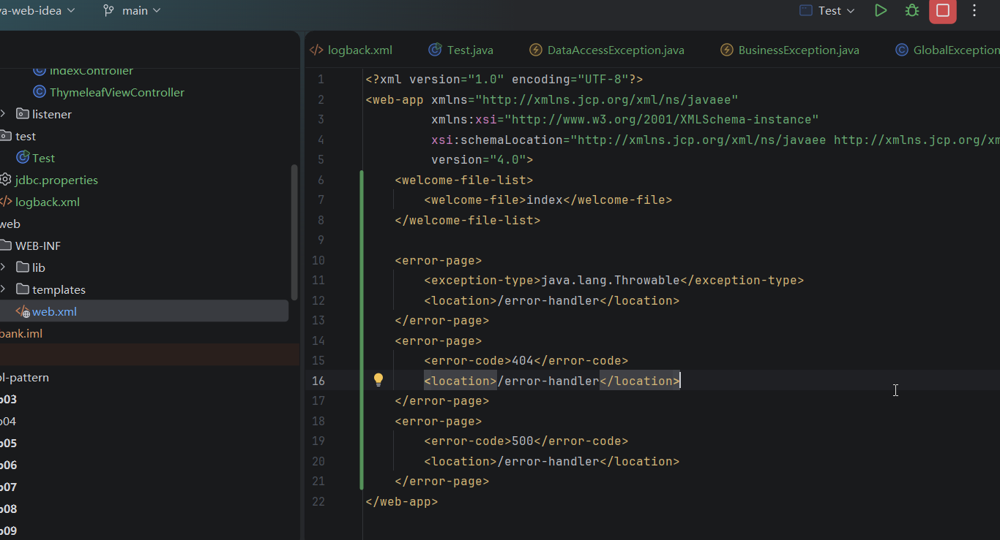


