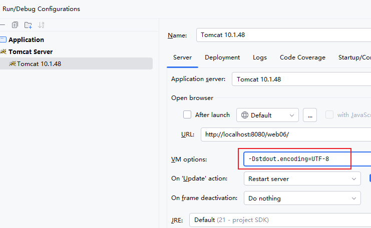

# 关于 Tomcat 标准输出流乱码问题

**当前环境信息如下：**

1. win10 简体中文环境
2. Tomcat 版本： 10.1.48
3. IDEA 版本：2025.2.2
4. JDK 版本：21

**前提是：**

1. IDEA 工具所有涉及到字符编码配置方面都已经配置了 UTF-8
2. Tomcat 服务器的 config/logging.properties 中的字符编码方式也都配置了 UTF-8

\*\*问题是：\*\*在这种情况下，在 Servlet 中使用 `System.out.println()`打印中文时仍然会出现乱码。

**什么原因？**

* 根本原因：Tomcat容器的标准输出流(System.out)编码与IDEA控制台显示编码不一致。
* 具体来说：Tomcat的System.out默认使用GBK编码输出，IDEA控制台期望接收UTF-8编码的文本，编码不匹配导致中文显示为乱码。
* 在 <code>Servlet</code>程序中可以通过 <code>**System.out.charset()**</code>**方法**来获取 Tomcat 容器的标准输出流的字符编码方式，结果是 GBK。
* **但需要注意的是**：脱离了 Tomcat 服务器之后，自己编写一个 main 方法，<code>System.out.charset()</code>方法获取的标准输出流的字符编码方式为 <code>UTF-8</code>。因此自己写的 main 方法输出中文不会存在问题。导致以上乱码的根本原因是 <code>Tomcat</code>服务器中的 <code>System.out</code>标准输出流采用的是和操作系统一致的 GBK。

\*\*怎么解决？在 Tomcat 服务器的 \*\*<code>**VM options**</code>**配置中添加这个配置：**-Dstdout.encoding=UTF-8

**另外，在这种环境下标准错误流通常也需要设置一下，不然在出现的异常中异常的描述信息是中文的话也会乱码，可以通过 **<code>**System.err.charset()**</code>**代码来查看标准错误流的字符编码方式，它应该也是 GBK。因此也需要在 **<code>**vm options**</code>**中进行配置：**<code>**-Dstderr.encoding=UTF-8**</code>

# 